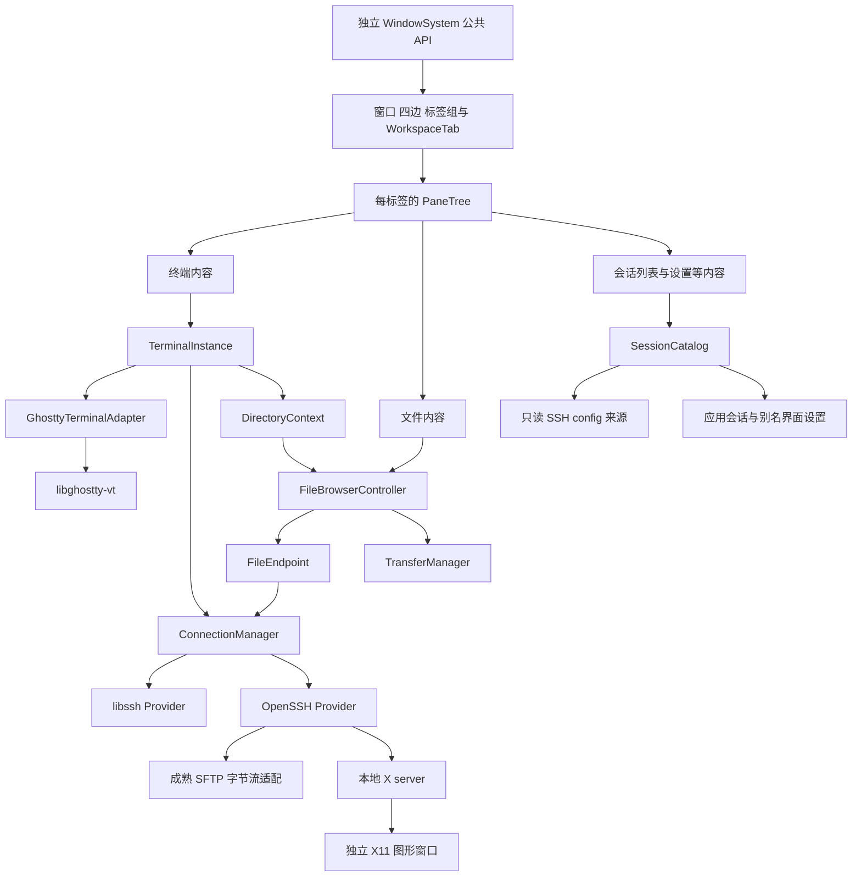

# Muxora V0 设计文档

版本：0.7，讨论稿\
日期：2026-10-11\
状态：产品行为、技术选型和实现边界的设计基线。窗口系统首个预览开始开发；当前实现与验证范围见 [预览说明](../development/window-system-preview.md)。文中的远程业务及第三方能力仍需分别完成构建与集成验证。

本文件保留产品与架构总览。详细规则见 [通用窗口系统设计](window-system-design.md)、[工作区与导航设计](workspace-design.md)、[设置与命令设计](settings-and-commands-design.md)、[终端 Normal 与选择模式](terminal-mark-mode-design.md)、[工程、资源与依赖设计](../development/engineering-design.md) 和 [自动化测试与质量要求](../development/testing-design.md)。

默认拖出轻量浮窗、转换完整窗口、整窗合并及拖拽唤起被遮挡目标的规则，见 [双窗口形态与跨窗口拖拽](floating-window-design.md)。

## 1. 要做什么

Muxora 是一款开源、可收费的跨平台远程工作空间。初版围绕 SSH 终端、会话管理、SFTP 文件管理和 X11 图形应用展开，把它们组织在同一套会话、连接和工作区里。

**V0 首发只构建、打包和验收 Windows 版，默认 Windows x64。** 架构为后续 macOS、Linux 留出平台边界，当前不要求编译其他系统，也不宣称这些系统已经通过集成验证。

日常使用应当像这样：在会话树中找到服务器，打开终端；终端旁边可以显示当前目录的文件；需要完整文件操作时，把文件面板展开为独立标签页；需要复制另一台服务器的文件时，切换为远程／远程双栏；启动远程 X11 程序后，它像其他桌面软件一样显示为独立窗口。

交互参考 Visual Studio 的停靠和多窗口体验，终端能力参考 Windows Terminal 与 iTerm2。这里的对标是常用能力和操作体验，不表示逐项复制这几个产品的全部功能。

V0 窗口壳与全部应用内控件的视觉以用户提供的 Visual Studio 2019 之后的截图为准，默认采用紫罗兰色系。通用窗口系统独立位于 `modules/window-system/`，其他代码通过公开 API 使用，后续项目可以复用。

### 1.1 设计原则

- **自由组织工作区**：所有功能内容统一为标签，可中央分组、四边自动隐藏／固定、独立成窗口；每个标签内部还可递归分割窗格。
- **操作迅速**：网络、目录扫描和传输不阻塞界面；标签组、组内标签与窗格有分别定义的键盘导航。
- **键盘驱动**：公开操作统一为命令，全部可绑定快捷键；命令面板、上下文规则、多键序列与终端本地 Normal／Visual 模式共同覆盖主要工作流。
- **节约资源**：不保存重复历史、不无限积累缓存或消息；已确认泄漏、无界增长和普通操作阻塞属于发布阻断项。
- **采用原生桌面技术**：以 Qt Widgets 为主，不引入 Electron 或 Qt WebEngine 作为终端运行环境。
- **复用成熟底层**：SSH、加密、认证、SFTP、VT 解析、终端状态和输入协议交给第三方组件。
- **统一功能**：终端和文件管理共享会话身份、连接上下文和操作入口。
- **窗口系统可复用**：窗口、标签、窗格、条带与样式具有独立公开 API，不依赖 SSH、Ghostty 或 Muxora 业务。
- **完整自动化测试**：从模型和独立 API 到真实协议、桌面、资源与发行包逐层验证；修复问题后通过检查，不得自行降低标准来通过测试。
- **留出扩展位置**：主题、协议、文件系统和视图都有明确边界，V0 不急于实现完整的第三方插件生态。

我们负责产品交互、状态协调、Qt 显示层和第三方适配。显示层也不能随意写：字体整形、输入法、字符占格和增量绘制都要依靠已有组件，并经过兼容性验证。

### 1.2 组件选型原则

用户允许采用 libssh、OpenSSH 或合理组合，具体方案由工程评估决定。选型以成熟、持续维护、开源可信、现代功能和稳定性为依据，并控制本项目需要承担的长期维护成本。

| 要求 | 评估依据 |
| --- | --- |
| 成熟、值得信任 | 有真实产品使用、清晰文档、测试及可核实的维护记录；不只看下载量或 GitHub 星数。 |
| 积极维护 | 查看实际功能修复、安全响应、发布和审查情况；不只用最新 release 日期或提交次数判断。 |
| 开源 | 源码、许可证和构建方式可获取，分发条件符合本项目；核心能力不依赖隐藏的商业组件。 |
| 现代功能 | 对照本项目的真实用例和协议能力表；区分解析、显示、输入、协商和跨平台支持。 |
| 稳定 | 分别评估核心功能、对外 API 与集成后的产品行为；成熟应用内部代码不自动等于稳定嵌入接口。 |
| 易于长期维护 | 尽量采用直接 API、明确生命周期和可隔离的适配；额外组件需要解决具体问题，并说明其成本。 |

不自行补写第三方库缺少的复杂协议、加密、终端解析或字体整形。确有缺口时先评估成熟实现；需要少量宿主协调的部分集中在适配层。

窗口与界面层不强制使用某个 Qt 控件或完整现成系统。适合则复用，不方便满足要求时可以自研布局、拖拽、条带或专用控件。公开 API 与功能规范由本项目定义，不为供应方删减交互要求。

维护状态在固定依赖版本和升级时重新核实。稳定版本、必要的上游修复、工具链与构建选项一起记录，避免依赖随开发环境变化而变化。

## 2. 本版建议的技术组合

| 层次 | V0 建议 | 使用理由及边界 |
| --- | --- | --- |
| 桌面界面 | C++20、Qt 6、Qt Widgets | 原生编译，桌面控件和平台集成成熟，便于以后自定义外观。Qt 原生风格不表示每个控件都是操作系统原生控件。 |
| 通用窗口系统 | 独立 WindowSystem 模块与公开 C++ API | 负责壳、统一标签、分割、导航、条带和状态栏；Muxora 只提供业务内容及操作。 |
| 停靠与多窗口 | 自有布局模型与停靠／拖拽实现，复用合适的 Qt 基础组件 | V0 不引入 KDDockWidgets；两种窗口壳共用两层布局与四边能力，支持窗口族、整窗拖拽及遮挡唤起。 |
| 标签内窗格 | 轻量 PaneTree，自研或合适的 Qt 分割组件 | 与外层标签组分割分开；选择不影响公开 API 和功能要求。 |
| 窗口壳与控件样式 | VS2019+ 参考、紫罗兰主题、统一视觉与 DPI 规范 | 顶部融合可移动菜单／工具条，底部全局状态栏，标签有可选上下栏；不采用未适配的 Qt 默认外观。 |
| 终端状态与协议 | `libghostty-vt`，通过 C API 接入 | 复用 Ghostty 的解析、屏幕状态、历史、重排和输入编码；不移植整个 Ghostty 桌面应用。 |
| 终端显示 | Qt 字体与绘制组件，加 Muxora 的网格显示适配 | 允许自绘上层；不自己实现字体整形器或另写 VT 状态机。 |
| 常规 SSH 与 SFTP | libssh | 负责认证、密钥、加密、通道、SFTP 等底层能力。 |
| OpenSSH 配置兼容、X11 转发 | 受控 OpenSSH 进程后端 | 补足 libssh 与 OpenSSH 的配置差异，并复用成熟 X11 转发流程。 |
| OpenSSH 后端下的 SFTP | 外部字节流 SFTP 适配，优先评估 `pkg/sftp` 小型辅助程序 | 用 OpenSSH 建立 SFTP subsystem 字节流，再交给现成 SFTP 库；避免自己实现协议或解析 `sftp ls` 文本。此组合尚需验证。 |
| 本地 X11 显示服务 | Windows：验收过的 VcXsrv 或 Cygwin/X；macOS：XQuartz；Linux：现有 Xorg/Xwayland | 图形窗口由系统桌面与本地 X server 管理。 |
| 应用设置 | VS Code 风格 JSONC 用户文件、schema 与统一设置服务 | `settings.json` 和 `keybindings.json` 支持注释、校验及运行中更新；状态使用独立严格 JSON，秘密进入系统凭据库。 |
| 构建与升级 | CMake、官方 Qt SDK、mise 环境、固定源码依赖与二进制缓存 | Qt 版本并行安装，项目固定使用版本；Ghostty 固定提交及 Zig，升级后重建、回归并发行。Go 仅在采用兼容 SFTP 辅助程序时需要。 |
| 自动化验证 | CTest、Qt Test、可复现服务与 Windows 桌面测试环境 | 覆盖独立窗口模块、真实 SSH／SFTP／X11、显示与输入、资源和最终包；失败不以删用例或放宽标准解决。 |

KDDockWidgets 已有丰富的分割、标签、自动隐藏和跨窗口能力，能够减少停靠交互工作，但不是必要依赖。我们仍需要自有两层布局、边缘固定语义、焦点导航和完整窗口壳；其深度定制还可能涉及私有 API。结合 MIT 与复用方向，V0 采用自有窗口实现，KDDockWidgets 保留为选型调查记录。自研意味着承担布局状态机、拖拽、DPI 和生命周期的测试与维护成本，不表示这些工作简单。[官方功能](https://kdab.github.io/KDDockWidgets/)、[私有 API 边界](https://kdab.github.io/KDDockWidgets/private_api.html)

**Ghostty 是当前首选，但其嵌入接口需要专门管理。** 官方明确说明 `libghostty-vt` 的 API 仍在开发，不能按稳定 SDK 对待。固定上游提交、头文件、构建选项和 Zig 版本，由一个适配层吸收变化。[libghostty-vt 状态](https://github.com/ghostty-org/ghostty#cross-platform-libghostty-for-embeddable-terminals)、[C API 声明](https://github.com/ghostty-org/ghostty/blob/main/include/ghostty/vt.h)

文档中的“支持”分为产品目标和已核实的上游能力。集成前不把“上游能解析”写成“Muxora 已经能正确显示和交互”。

本稿继续以 libssh 作为常规 SSH／SFTP 的主方案。OpenSSH 用于已明确的配置兼容和 X11 场景，具体适用范围由集成验证确定；额外的 SFTP 字节流辅助程序也属于待验证方案，不预先扩大到所有连接。

用户使用一套会话、终端和文件管理功能。后端差异集中在 `ConnectionManager` 及协议适配中，设置来源、目录跟随和文件界面不各自维护后端选择逻辑。是否保留两个 SSH 后端最终取决于它们解决的问题与实际成本，不因一次选型讨论就更换整套架构。

## 3. V0 范围

| 功能 | V0 要求 |
| --- | --- |
| 首发平台 | 只构建和验收 Windows，保留未来 macOS／Linux 的明确平台边界。 |
| SSH 终端 | 连接、认证、主机密钥校验、断开、重连、调整尺寸、多个终端实例。 |
| 本地终端 | 2026-10-19 新增：通过 ConPTY 运行本机 shell，包括 Windows PowerShell、PowerShell 7、cmd、各 WSL 发行版、Git Bash；自动检测与自建配置，外部来源只读。见 [本地终端设计](local-terminal-design.md)。 |
| 会话管理 | 应用自建会话，以及从 SSH config 动态生成的会话；分组、搜索、收藏、排序。 |
| SSH config | 默认只读使用，启动及运行中发现变化；按别名附加应用设置。可选：允许修改并写回原文件、应用会话与 SSH config 双向同步（[设计](ssh-config-sync-design.md)）。 |
| 工作区 | 所有功能内容统一为标签；四边收纳／固定、中央自由标签组、标签内递归窗格；轻量／完整窗口转换、整窗及单标签拖拽、遮挡目标唤起与图形投放辅助。 |
| 键盘与命令 | 所有公共命令可绑定；命令面板、条件、参数、多键序列、冲突及默认解绑；标签组、标签、窗格及业务工作流都可键盘操作。 |
| 终端本地 Normal 模式 | Vim 风格浏览、计数、查找、字符／整行／矩形 Visual 选择、端点切换与复制；模式内操作键不发送 SSH。 |
| 设置与状态 | VS Code 风格图形设置及 settings.json／keybindings.json；自建会话分文件，SSH 别名只读附加设置；两种窗口、窗口族及布局状态独立保存。 |
| 工程质量 | 明确所有权、受控队列与缓存、可维护模块、可升级依赖；完整自动化用例、真实端到端和资源／发行包检查，不自行降低测试标准。 |
| 文件管理 | SFTP 浏览、上传、下载、基本文件操作、单栏和双栏、远程／远程复制。 |
| 终端文件侧栏 | 复用文件浏览器，支持跟随终端当前目录和固定目录两种状态。 |
| X11 | 使用成熟转发与显示组件；远程图形程序显示为正常独立窗口。 |
| 字体 | 逗号分隔的有序字体列表、缺字回退、中文输入、组合字符、Emoji 和 DPI 适配。 |
| 窗口壳与视觉 | VS2019+ 风格、紫罗兰配色、可移动并锁定的菜单／工具条、底部状态栏、标签可选上下附加栏、高 DPI 清晰度。 |
| 自定义与复用 | 快捷键、字体、终端配色、条带与工作区布局；独立窗口 API、可替换主题与内部实现。 |

完整 Aero 外观、RDP/VNC、原生 Wayland 远程应用转发、FTP/WebDAV、插件市场、多人协作、自动同步目录和完整脚本系统留到后续版本。X11 转发不等同于整套远程桌面。

## 4. 界面与工作区

### 4.1 默认布局

```text
┌──────────────────────────────────────────────────────────────────┐
│ 标识／可移动菜单条／命令入口／拖窗区／窗口按钮                    │
│ 可移动工具条与其他命令块                                          │
├──┬───────────┬───────────────────────────────────────────────────┤
│左│ [会话]    │ 标签组 A：[终端 dev][文件 dev]                    │
│边│ 固定标签  ├───────────────────┬───────────────────────────────┤
│栏│           │ 文件窗格          │ 终端窗格                      │
│  │           │ dev /srv/project  │                               │
├──┴───────────┴───────────────────────────────────────────────────┤
│ 下自动隐藏栏：[传输队列]                                          │
├──────────────────────────────────────────────────────────────────┤
│ 就绪／当前操作                          连接／传输摘要／通知        │
└──────────────────────────────────────────────────────────────────┘
```

图中是完整工作窗口的初始位置。会话列表、传输、终端、文件等都是同等的 `WorkspaceTab`；用户可把任意标签移到中央、四边或两种独立窗口。完整壳提供融合顶部命令区和底部全局状态栏，轻量壳只显示紧凑标题栏及内容；功能内容不因类型被永久固定。

### 4.2 四边自动隐藏与固定

左、右、上、下分别有自动隐藏条带，空栏隐藏，有条目时出现。默认点击展开为当前窗口的覆盖层，不改变中央布局；点击固定后进入对应边缘区域，正式占据空间；取消固定回到条带。固定边缘区域独立于中央标签组分割。

临时覆盖层收起后停止无效绘制，活动连接和协议处理继续。功能标签都可采用这套行为，不只文件浏览器可进入侧栏。每个独立工作区窗口具备相同四边栏。

### 4.3 两层自由分割

外层中央区域可以递归划分多个标签组；一个标签组就是用户所说的“tab 列”，可叠放多个标签。内层每个标签有自己的窗格树，可以递归上下或左右分割。两层分别导航、调整大小，不采用固定两列或四格模板。

拆分终端窗格创建新的远程 shell；移动现有标签或提取窗格保留原实例。窗格可通过快捷键、菜单和命令面板移成独立窗口，V0 不要求直接拖拽窗格到桌面。

### 4.4 拖拽、窗口与键盘

- 拖拽显示 Visual Studio 截图所示的图形方向目标和落点预览。中央分割、组内合并、四边收纳使用可区分的目标。
- 标签默认拖出为归属于原完整窗口的轻量浮窗，也可显式移到新的完整窗口或设置拖出默认类型；两种窗口均支持多标签、分组分割及标签内窗格。
- 浮窗可升级为完整窗口，完整窗口可选择另一完整根后降为浮窗；单标签可跨任意本进程工作窗口拖动，连接、历史与内容 ID 保持。
- 拖动轻量浮窗标题栏可搬动全部内容：投到组中心合并为标签，投到方向目标保留分组；没有有效目标则只是移动该浮窗。来源边缘内容按明确预览转换，不遗漏收纳标签。
- 拖拽时悬停被遮挡的目标窗口可将其抬前，默认延迟 500 ms；保持拖拽捕获，成功放下才聚焦内容。完全遮挡或最小化窗口可通过目标选择器显式选中。
- 窗口族内／全部窗口／仅完整窗口切换、返回所属完整窗口、类型转换及整窗移动也注册为命令和可重绑快捷键。
- 标签组上下左右导航、组内前后切换、当前标签的窗格上下左右导航分别注册为命令。
- 内外两层都有尺寸调整命令，所有快捷键可重绑定，菜单与命令面板调用同一入口。
- 保存四边、窗口、中央标签组与标签内窗格布局；离屏窗口恢复到可见区域。重启恢复结构，重新连接遵循会话规则。

一个活动终端实例在 V0 只由一个主视图负责输入和尺寸。以后如果支持同一终端多视图镜像，需要另外定义谁拥有 PTY 尺寸与输入控制权。

移空的轻量浮窗自动清理；完整空窗口可设置保留或自动关闭，默认保留。判空包含整个窗口族，根无标签但仍有浮窗时不能自动关闭。关闭浮窗只协调本窗内容；显式关闭完整根先协调全族，任一拒绝则取消整次关闭。正在传输的任务属于应用任务管理器，不能因为文件标签移走或窗口关闭就意外终止。详见双窗口设计。

### 4.5 X11 窗口的行为

**X11 图形窗口不嵌入标签页。** 它们由本地 X server 显示为正常桌面窗口，像其他图形程序一样移动、最大化、关闭。Muxora 可以显示转发状态或提供启动入口，但不要求把这些窗口停靠回工作区。

全部应用内功能标签均可收纳和分组；X11 外部窗口继续由正常桌面管理，不列入工作区停靠系统。详细状态、导航和适配规则见 [工作区与导航设计](workspace-design.md)。

### 4.6 顶部条带与全局状态栏

完整窗口最顶层直接显示融合的菜单／命令区，不再额外叠一条传统标题栏。菜单条、工具条及独立命令块可以解锁拖动、换位与换行，然后锁定。锁定只限制用户重排，不禁用命令；窄窗口临时溢出不覆盖用户保存的布局。轻量浮窗省去这些应用条带，使用可整窗拖动的紧凑标题栏。

底部全局状态栏呈现就绪、当前操作与连接／传输／通知摘要。壳仍保留原生窗口移动、resize、系统菜单、最大化、任务栏与 Snap；高 DPI 下命中与显示一致。

### 4.7 标签可选上下栏

每个标签可设置内容上方的导航／操作栏与内容下方的信息栏。上栏可包含路径、筛选、下拉框、搜索或按钮；下栏可包含缩放、位置、连接或选中项统计等。

两栏分别可选，未设置或明确清空时不显示、不占高度；它们随标签切换、收纳和跨窗口移动。窗格也可以使用相同能力按自身 ID 绑定，提取时保留正确归属。它们与窗口底部全局状态栏分开。

### 4.8 独立公开 API

WindowSystem 在项目内有独立源码目录、构建目标、头文件、测试和外部宿主验证夹具。用户试用的首个预览就是 Muxora 应用，后续产品继续使用这套代码。其他代码通过 API 创建窗口、添加内容、设置上下栏、分割、移动、关闭和保存布局；自动创建／恢复内容与命令注册只是可选接入方式。

模块不依赖 SSH、SFTP、Ghostty 或 Muxora 配置。宿主视图与栏的所有权、调用成功／失败、移动及移除规则明确。实际目录入口见 [WindowSystem](../../modules/window-system/README.md)，规范见 [通用窗口系统设计](window-system-design.md)。

## 5. 会话管理与 SSH config

### 5.1 两种会话来源

**应用会话**由 Muxora 保存。用户可以设置地址、用户、端口、认证方式和其他连接选项，也可以设置字体、颜色与文件布局。

**SSH config 会话**由本机当前配置动态生成。默认用户配置为用户主目录下的 `.ssh/config`；Windows 使用用户主目录，不硬编码盘符。配置通过 `Include` 引用的文件也属于这个来源。系统级配置按选定 SSH 后端的正常读取规则参与求值，来源和后端应可在详情中查看。

SSH config 会话不是一次性导入。应用设置中不保存一份可脱离原文件继续使用的连接配置。

### 5.2 只读规则

> **2026-10-19 修订**：只读是默认行为。设置中新增两个独立选项：`ssh.config.allowEditing`（允许在 Muxora 中修改 SSH config 中的连接，修改写回原文件）和 `ssh.config.syncAppSessions`（应用会话实时同步到一个由 Muxora 管理、并通过 `Include` 接入 `~/.ssh/config` 的文件）。两个都关闭时，本节规则完全不变。打开后的写入方式、不破坏无关配置的规则、冲突与开关切换的处理见 [SSH config 修改与同步设计](ssh-config-sync-design.md)。

Muxora 不提供通过会话设置修改 SSH config 的入口，也不通过自己的设置覆盖该来源的地址、用户、端口、密钥、代理或认证参数。详情页可以只读显示来源、别名和有效连接信息。

按别名保存的扩展设置可以包括：

- 会话树里的显示名、分组、收藏、排序和标签颜色。
- 字体列表、字号、终端配色、光标样式和快捷键方案。
- 文件浏览器的单栏／双栏偏好、目录收藏和终端侧栏状态。
- 应用内布局及其他不重定义原连接身份的设置。

这些设置写入 Muxora 自己的配置目录，与 `.ssh/config` 分离。内部身份采用“配置源 ID + 原始别名”，不采用解析后的 IP。同一服务器的两个别名可以拥有不同界面设置；别名移动到另一个 Include 文件后仍可对应原设置。

**只读规则约束的是软件的编辑和设置行为。** 它不要求应用因为遇到某个不支持的配置项就拒绝连接。能建立连接就应建立连接；配置兼容问题通过成熟后端解决，不能把它变成产品层面的额外门槛。

### 5.3 自动发现与刷新

启动时读取当前来源，在后台生成会话列表。运行期间监听根配置、已发现的 Include 文件以及相关目录；Include 的 glob 范围也要发现新文件。

监听事件先合并，再重新构建完整索引，并一次性更新界面。处理文件原子替换、删除后重建、Include 新增或移除、文件夹重命名等情况。Qt 在文件被重命名或删除后会停止对应文件的监听，因此需要监听父目录并重新登记文件。[QFileSystemWatcher](https://doc.qt.io/qt-6/qfilesystemwatcher.html)

刷新会话树时，只做不执行命令的结构索引：寻找明确的 Host 别名和 Include 依赖，不在后台运行 `Match exec`。最终连接参数由 SSH 后端在连接时求值。

索引规则：

- `Host dev build` 产生 `dev`、`build` 两个入口。
- `Host *`、`Host *.example.com` 和否定模式是匹配规则，不凭空生成服务器清单。
- 同一别名出现于多个配置块时，作为一个入口，由后端处理配置顺序；不能自己采用“最后一块覆盖前一块”。
- 条件规则不通过后台执行来展开；用户可以发起一次按别名的连接，再由后端判断条件。
- 支持通过快速连接显式输入名称，使用通配规则。这个操作不把已删除的旧别名自动恢复到会话树。

多文件读取不天然原子。刷新时记录文件状态，完成后复核；发现读取期间变化时有界重试。短暂保存中的中间状态先合并处理，不急于清理设置。读取失败则显示来源错误，不凭旧连接参数建立新连接。

相对 Include 路径、通配展开和顺序遵守来源规则，而不是一律相对当前文件所在目录。[OpenSSH 配置手册](https://man.openbsd.org/ssh_config#Include)

### 5.4 删除别名

确认一次完整、有效的刷新中已没有某个明确别名后：

1. 从会话树移除该条目，不显示“已删除会话”分组，不保留可连接的历史入口。
2. 同次设置更新中原子提交扩展设置的删除，使旧记录可靠失效；后台仅清理旧记录 ID／版本对应的缓存与附属数据，避免误删随后新建的同名条目。
3. 不通过历史地址、缓存参数或通配匹配偷偷恢复该入口。
4. 已经打开的终端可以继续工作，但它是活动连接，不是保留下来的配置会话；关闭后不作为旧会话恢复。
5. 此后重新添加同名别名，作为新条目使用默认应用设置，不自动复活旧设置。

原配置在活动连接期间发生改变，不主动断开既有连接；下一次连接和重连重新读取当前来源。别名已删除时，不能用旧快照自动重连。

### 5.5 配置兼容策略

libssh 提供现成配置解析，但其行为与 OpenSSH 并不完全相同。比如部分 Match 条件、规范化、某些认证及主机密钥选项存在差异。不能因为库接受了文件，就宣称所有配置均已按 OpenSSH 语义执行。[libssh 0.12.2 配置实现](https://gitlab.com/libssh/libssh-mirror/-/blob/libssh-0.12.2/src/config.c)

V0 使用以下策略：

- 常规配置在通过验证的范围内使用 libssh。
- 不影响本次操作的配置差异可以作为诊断信息，不因差异本身阻断连接。
- 配置依赖 libssh 尚不具备的实际能力时，使用 OpenSSH 后端，直接让 OpenSSH 按原别名读取原来源。
- 不能把某次认证拒绝、主机密钥变化或 MFA 错误简单当成“后端不兼容”，然后换后端重试以绕过检查。
- 后端选择提供清晰状态，必要时允许用户对这个别名选择 OpenSSH 后端；这属于应用执行方式，不修改原文件的连接参数。
- 不为了连接成功而悄悄关闭主机密钥校验、换用户名、绕过跳板或重新启用旧算法。

OpenSSH 兼容方案应覆盖终端和文件管理。不能只让终端连接成功，再让同一会话的文件浏览器因为仍使用不兼容的 libssh 后端而失效。

`ssh -G` 可以用于用户发起的诊断，但不在启动和后台监听时批量运行。它会求值 `Match exec`，部分配置还会触发 DNS 等行为；把输出映射到 libssh，也不等于完整 OpenSSH 兼容。[ssh 手册](https://man.openbsd.org/ssh)、[OpenSSH 配置实现](https://github.com/openssh/openssh-portable/blob/master/readconf.c)

## 6. SSH 连接与生命周期

### 6.1 基础连接能力

V0 包含密码、公钥、加密私钥口令、可用的 SSH agent，以及 keyboard-interactive／MFA 提示。具体密钥格式、硬件密钥、agent 和平台组合由后端能力与验收结果确定，不从“支持 SSH”推出所有密钥方式都已完成。

主机密钥检查使用后端成熟接口。首次接受主机密钥可以更新正常的 `known_hosts`；这与“不修改 SSH config”是两件事。主机密钥改变必须呈现实际信息，不能静默接受。[libssh 连接教程](https://api.libssh.org/stable/libssh_tutor_guided_tour.html)

连接、认证、通道建立、远端断开和本地取消都是独立状态。UI 显示当前状态及可取消操作；网络超时不冻结窗口。

### 6.2 libssh 后端

配置来源会话先以原别名创建连接上下文，再让 libssh 解析来源。不要预先塞入应用默认 User、Port、IdentityFile 等，导致显式选项覆盖用户配置。解析结果只用于本次连接，不反向写入原配置。[libssh 配置选项接口](https://gitlab.com/libssh/libssh-mirror/-/blob/libssh-0.12.2/src/options.c)

一个 SSH transport 可按后端能力承载多个 shell 和 SFTP 通道。终端实例、SFTP 通道和 transport 的生命周期分别管理。为了交互公平性，必要时为大量文件传输建立独立 transport；不能假设共享一条连接就必然响应更快。

libssh 同一 session 不被多个线程随意并发调用；由连接执行器串行管理，向 UI 发送结果和状态。具体异步策略在集成验证后固定。

### 6.3 OpenSSH 后端

OpenSSH 后端运行经过验证的 OpenSSH 客户端，让它处理原始来源的配置、代理、认证及 X11。用绝对程序路径和参数数组启动，不把本地参数拼成 shell 命令。

两后端的配置源集合必须一致。默认用户来源按正常规则读取用户及系统配置；自选来源另行定义是否包含系统配置，并在两后端一致落实。OpenSSH 的 `-F` 会改变读取范围并忽略通常的系统配置，不能在切换后端时随意添加。[OpenSSH 参数与配置说明](https://man.openbsd.org/ssh)

终端原始输出、诊断 stderr、认证提示和协议数据分开处理。标准 askpass、agent 和密钥流程由适配层接入界面；秘密不放入命令行、普通环境变量或日志。

终端视图仍使用同一个 Ghostty 核心。适配层必须验证原始字节往返、远端 PTY 尺寸变化、输入法、控制键和能力回复。尤其要验证 Windows 客户端的管道／PTY 行为，避免中间终端再次解释并丢失控制序列。这个后端是否能满足全部现代终端用例，要通过实际测试确认。

OpenSSH 文件通道以无 PTY 的方式启动实际 SFTP subsystem，例如采用 `-T -s`，再将二进制字节流交给第三方协议库。stdin／stdout 不经文本解码、换行转换或终端处理，stderr 与认证交互也不能混入协议流；这项运行方式在原配置请求强制 PTY 时也要正确落实。[OpenSSH subsystem 参数](https://man.openbsd.org/ssh)

`pkg/sftp` 的 `NewClientPipe` 官方支持系统 SSH 客户端的输入输出流；建议封装为按需启动的小型本地辅助程序。它会增加构建、IPC 和进程成本，应在原型阶段测量；主程序不因此依赖 Electron 等运行时。[pkg/sftp API](https://pkg.go.dev/github.com/pkg/sftp#NewClientPipe)

备选为接受通用异步字节流的 `russh-sftp`。目前不同时引入两套辅助实现；若换用它，应整体替换这一适配方案。[russh-sftp 接口](https://docs.rs/russh-sftp/latest/russh_sftp/client/struct.SftpSession.html)

### 6.4 实例与连接分离

- 一个会话配置可以打开多个终端实例。
- 一个终端实例绑定一个远程 shell／PTY 和一个终端状态实例。
- 文件视图绑定文件端点，不绑定某个 QWidget 的生命周期。
- 目录跟随绑定具体终端实例，不只绑定服务器别名。
- 传输任务绑定源端点和目标端点，独立于标签页所在窗口。
- 拖出、合并、切换标签、修改配色都不改变连接身份。

重连会建立新的远程 shell，不可能自动恢复已丢失的远程进程。需要持续工作时可以使用远端 tmux；Muxora 不把普通重连包装成进程恢复。

## 7. 终端设计

### 7.1 分工

```text
远端 shell／PTY
      ⇅ SSH 字节流
libssh 或 OpenSSH transport
      ⇅ 原始字节／有序发送队列
GhosttyTerminalAdapter
      ⇅ libghostty-vt 状态、输入编码与回调
Qt TerminalView + 字体整形与绘制
```

Ghostty 负责控制序列、屏幕网格、光标、颜色、历史、换行、重排和终端输入协议。Qt 负责显示字形、输入法、选区交互和桌面集成。Muxora 负责两者的协调。

不能将终端输出解码成字符串后追加到 QTextEdit。也不自己维护第二套光标、换行和字符宽度状态机。

### 7.2 TERM 与通用现代能力

默认远端 PTY 类型为：

```text
TERM=xterm-256color
```

不默认使用 `xterm-ghostty`，不自动安装 Ghostty 专用 terminfo，不要求远端使用 Ghostty 的 SSH 包装功能。iTerm2 也推荐通用的 `xterm-256color` 配置；它适合作为广泛兼容的默认声明。[iTerm2 FAQ](https://iterm2.com/faq.html)

TERM 是应用读取的能力声明，不是关闭 Ghostty 现代解析能力的开关。真彩色、Unicode、鼠标和其他扩展是否被远端应用使用，还与环境声明、查询、协商和应用配置有关。通用 terminfo 可能缺少某些扩展声明，不能承诺所有程序自动启用全部高级功能。[Ghostty terminfo 说明](https://ghostty.org/docs/help/terminfo)

尽量请求 `COLORTERM=truecolor`；SSH 服务端可能拒绝环境变量请求，需要呈现真实状态，不把请求成功发送当成远端已经接受。已有来源明确设置的环境策略不由隐藏默认值覆盖。

保留共享现代协议，如 OSC 8、OSC 7、同步输出和协商后的扩展键盘协议。这里“不使用 Ghostty 专用 TERM”不表示排斥来自其他终端、已被多个项目采用的扩展。只回复当前集成真正可用的能力，不伪装成 Ghostty 桌面应用，也不冒用其他产品身份。

### 7.3 V0 终端能力表

| 能力 | V0 设计目标／限制 |
| --- | --- |
| vim、less、top、htop、tmux 等全屏程序 | 基础验收要求，包含备用屏幕、尺寸变化和鼠标操作。 |
| 256 色、24 位真彩色 | 必须支持解析与显示；应用是否自动启用真彩色另行验证。 |
| UTF-8、中文、宽字符、组合字符、Emoji | 必须支持，关注占格和字体回退。 |
| 中文输入法 | 必须支持预编辑、候选窗位置及提交，避免重复发送。 |
| 光标、粗体、斜体、删除线、不同下划线 | 显示层覆盖核心给出的样式；缺少字体样式时有一致处理。 |
| 鼠标、焦点报告、括号粘贴 | 由核心按当前终端模式编码。 |
| OSC 8 链接 | 可显示与打开；不会把远端链接作为自动执行命令。 |
| 滚动历史、搜索、选择复制、窗口重排 | 必须支持；历史有可配置上限。 |
| 本地 Normal／Visual 键盘模式 | V0 必需；可配置 Vim 风格移动、计数、查找与三种选择，使用核心的选择及跟踪接口，具体规则见独立设计。 |
| Kitty 键盘协议、modifyOtherKeys | 使用现成编码器，按远端协商状态启用。 |
| 同步输出 DEC 2026 | 支持完整画面提交，并处理异常未释放状态。 |
| OSC 7 当前目录 | 用于文件面板跟随，不依赖 Ghostty 专用 TERM。 |
| OSC 52 剪贴板 | 通过宿主策略控制；读剪贴板默认禁止，写入由设置和提示管理。 |
| Kitty 图片协议 | 作为增强目标，需要构建开关、图片解码、资源限制和绘制集成后才能宣告可用。 |
| Sixel、iTerm2 图片协议 | 当前 Ghostty 方案存在缺口，不列为 V0 已支持能力。 |
| 非 UTF-8 老编码 | V0 以 UTF-8 为主，不承诺 GBK／Big5 等任意字节流自动识别。 |

Kitty 键盘协议有运行时查询和协商，不要求 TERM 必须叫 Ghostty。[键盘协议](https://sw.kovidgoyal.net/kitty/keyboard-protocol/)

Ghostty 当前不支持 Sixel；iTerm2 文件图片序列的解析不等于图片显示实现。如果以后把这些协议列为必需项，应重新评估终端核心或寻找成熟扩展，不能靠改 TERM 解决。[Sixel 上游说明](https://github.com/ghostty-org/ghostty/discussions/2496)、[iTerm2 序列实现](https://github.com/ghostty-org/ghostty/blob/main/src/terminal/osc/parsers/iterm2.zig)

### 7.4 宿主适配不能遗漏的行为

核心写入字节后，不会自动把应答发送到 SSH。必须接入 `WRITE_PTY` 回调，将回复和输入按顺序送入同一发送队列；标题、响铃、尺寸、剪贴板等副作用也要分别接入。普通 UI 副作用在同步回调中复制或投递；尺寸、设备能力等查询同步返回已准备的数据。回调不做阻塞网络操作，不重入 VT 写入；同步输出的状态捕获按下面的专门规则处理。[终端宿主接口](https://github.com/ghostty-org/ghostty/blob/main/include/ghostty/vt/terminal.h)

键盘、鼠标、焦点、粘贴使用上游编码器，并同步当前终端模式。危险粘贴确认时使用固定文本快照；IME 提交作为文本输入处理，不能当成剪贴板粘贴或同时再发送一次按键。[输入编码](https://github.com/ghostty-org/ghostty/blob/main/include/ghostty/vt/key/encoder.h)、[粘贴接口](https://github.com/ghostty-org/ghostty/blob/main/include/ghostty/vt/paste.h)

渲染读取稳定快照与 dirty rows，避免 UI 同时访问正在变动的状态。收到同步输出开始的 `RENDER_HOLD` 回调时，立即捕获该时点的完整显示状态，不能延后到 UI 再读取。随后继续接收、解析数据，显示保留捕获的画面，结束时提交新画面。宿主设置超时，必要时解除同步输出模式，防止画面永久冻结。具体处理遵循固定版本的 API。[增量渲染接口](https://github.com/ghostty-org/ghostty/blob/main/include/ghostty/vt/render.h)、[同步输出宿主规则](https://github.com/ghostty-org/ghostty/blob/main/include/ghostty/vt/terminal.h#L1545)

图片功能如启用，采用成熟 PNG 解码器，并限制字节数、像素尺寸和总缓存。远端给出的本地文件路径不能直接用于读取客户端文件。[Ghostty 图片宿主接口](https://github.com/ghostty-org/ghostty/blob/main/include/ghostty/vt/sys.h)

## 8. 字体与输入法

### 8.1 用户设置

字体设置接受类似 VS Code 的有序列表：

```text
"JetBrains Mono", "Sarasa Mono SC", "Noto Sans Mono CJK SC", monospace
```

优先级从左到右。允许空格和引号，忽略空项，保存为真正的数组；`monospace` 表示平台等宽字体兜底。示例中的字体不表示产品默认捆绑或每台机器都已安装。

设置页显示字体是否存在，提供中英文、框线、组合字符、Emoji 和粗斜体预览。字体缺失时继续回退，并显示实际使用字体，不能悄悄把回退链丢掉。

支持全局默认、会话字体方案和终端实例的临时字号。临时缩放不会改 SSH config。

### 8.2 渲染规则

- 主等宽字体确定单格宽度、行高和基线。
- Ghostty 状态确定字符簇占用的格子，回退字形不改变终端列坐标。
- 组合字符和 ZWJ Emoji 按字符簇处理，不能逐码点拆开绘制。
- 字形整形使用 Qt 的文本组件；渲染保留“字形位置到终端格子”的映射。
- 回退字体尺寸与基线需要适配。不能用补空格或修改字符串修复中文对齐。
- V0 默认关闭装饰性编程连字，先保证选择、光标和列对齐；复杂文字必要的整形仍保留。
- 字体、字号、样式、DPI 或显示器变化后更新缓存、网格和远端 PTY 尺寸。

Qt 提供字体 families、自动缺字回退，以及 Qt 6.8 起按 script 的应用回退列表；Emoji 配置接口从 6.9 起提供。但应用级回退列表不是每个终端独立的配置。每会话有序回退由 `TerminalFontResolver` 封装，使用 Qt 字体匹配、覆盖查询与整形能力，不能切换活动标签时修改全局列表，导致其他终端的字体变化。[QFont](https://doc.qt.io/qt-6/qfont.html)、[QFontDatabase](https://doc.qt.io/qt-6/qfontdatabase.html)

基于这些能力，V0 的 Qt 下限建议为 6.9；开始实现时再固定当前适合分发的版本。

`QTextLayout`／`QGlyphRun` 结果缓存到文本、字体方案、样式与 DPI 对应的键中，仅重整形变动区域。不要每帧为所有字符调用昂贵的字形查询。[QTextLayout](https://doc.qt.io/qt-6/qtextlayout.html#glyphRuns)

IME 候选窗位置跟随实际光标格子。预编辑由本地显示层处理，提交文本才进入终端编码与 SSH 发送流程。[QInputMethodEvent](https://doc.qt.io/qt-6/qinputmethodevent.html)

## 9. 统一文件浏览器

### 9.1 同一功能的三种呈现

**单栏文件标签页**用于资源管理器式远程浏览：地址栏、后退／前进、上级目录、目录收藏、文件列表和操作菜单。支持把本地资源管理器中的文件拖到远程目录上传。

**双栏文件标签页**包含两个独立端点选择器。端点可以是本地目录或任一远程会话，因此可表示本地／远程、远程／本地、远程／远程。两个远程端点也可以是同一台服务器上的两个目录。

**终端关联文件窗格**复用相同文件模型、导航状态和操作服务，在终端标签内以较窄布局显示，可跟随绑定终端的目录。它也能成为文件标签，进入中央或窗口四边；移动时带走端点、目录和绑定，不重新导入或认证。标签内的关联文件窗格与窗口级自动隐藏栏是不同布局位置。

不维护三套文件管理实现。它们共用 `FileBrowserController`、目录模型、端点接口和传输任务管理器。一个标签含多个终端时，文件视图明确绑定具体 Terminal／Pane ID；切换焦点不会未经约定地改变文件端点。

### 9.2 基础操作

V0 支持列目录、排序、刷新、显示隐藏文件、创建目录、重命名、删除、查看属性、基础权限操作、上传和下载。对服务器没有的操作显示能力限制。

文件名和路径按结构化数据处理，不通过拼接 `ls`、`rm` 等远端 shell 命令完成基本文件操作。目录符号链接与真实路径区分显示；默认不递归跟随符号链接。远端任意字节文件名的显示与回传需要验证，不能因转成 UTF-8 替换字符而操作错文件。[libssh SFTP 文档](https://api.libssh.org/stable/libssh_tutor_sftp.html)

拖到文件列表是上传／复制；拖到终端是按当前 shell 规则插入路径，行为由目标区域明确区分。不能因为拖到了终端就偷偷上传或执行命令。

从应用拖出远程文件到系统资源管理器涉及各平台的数据承诺和临时下载机制，属于后续增强；V0 提供明确的下载入口。

### 9.3 两台服务器之间的复制

V0 默认采用客户端流式中转：

```text
服务器 A 的 SFTP 读取
           ↓
客户端有上限的缓冲区
           ↓
服务器 B 的 SFTP 写入
```

用户在双栏中选择 A 和 B，拖拽或发起复制即可。服务器之间不需要直连，不需要在 A 上存放 B 的凭据，也不需要默认开启 agent forwarding。界面标明“经本机中转”，避免让用户误认为流量不经过客户端。

不默认把整个文件先下载到本地磁盘。按块读取与写入，使用背压控制内存；速度受两条连接与客户端网络限制。WinSCP 也说明远端直传涉及服务器认证和配置，不能把它当成 SFTP 自带的通用能力。[WinSCP 远端传输说明](https://winscp.net/eng/docs/faq_fxp)

可暂停任务并保留进度；恢复前验证源与目标状态。跨连接、跨重启的断点恢复不是无条件保证。取消和失败时保留或清理部分文件的方式有明确提示。

默认写入目标目录下的临时文件，完成后再按服务器能力提交为目标文件名。覆盖策略包含询问、跳过、重命名、覆盖；不把所有服务器的 rename 都假设为可覆盖的原子操作。不能为了覆盖而先无条件删除旧文件。

目录复制采用受限队列遍历，不一次将整个目录树读入内存。属性保留以服务器与本地文件系统实际支持为准；权限、所有者、ACL 和时间戳分别处理。

同服务器移动优先使用 rename。跨服务器 V0 默认只做复制，不在成功后自动删除源文件。后续直传策略可接入，但不是默认功能。

## 10. 终端目录跟随

### 10.1 目录从哪里来

优先使用 shell 主动发出的通用 OSC 7 当前目录报告。Ghostty 和 iTerm2 都有相关支持，这不要求专用 TERM。[Ghostty OSC 7](https://ghostty.org/docs/vt/osc/7)、[iTerm2 当前目录报告](https://iterm2.com/documentation-escape-codes.html)

不靠匹配终端提示符猜目录；不周期性向用户的终端输入 `pwd`。单独的 exec 通道也不能查询另一个 shell 内部 `cd` 后的目录。

远端已经发送 OSC 7 时直接使用；未发送时，用户可以启用可撤销的 shell 集成。V0 优先支持经过测试的 Bash、Zsh 和 Fish 方案，提供可查看的脚本。自动部署或修改远端启动文件必须是用户明确发起的操作，不能因为连接服务器就默默改配置。

没有可靠目录报告时，侧栏仍能手动浏览，显示“目录跟随未启用”。

### 10.2 跟随状态

- **跟随终端**：收到有效目录报告后导航到对应目录，并刷新文件列表。
- **固定目录**：用户可以暂时浏览其他目录，终端 `cd` 不把面板强制拉回。
- **恢复跟随**：回到最新可靠报告的目录。

面板浏览不会自动在终端执行 `cd`。需要反向导航时提供明确操作，按已知 shell 做安全路径引用；它是用户发起的命令，不是后台同步动作。

目录报告与具体终端实例绑定。切换窗口或移动终端标签不改变绑定；一个终端的目录变化不能刷新同服务器下另一个终端的侧栏。

tmux、嵌套 SSH、sudo、容器和 chroot 可能导致报告来自不同主机或文件系统上下文。校验 URI 的主机、路径和当前文件端点；不能用另一台机器的路径去操作原服务器。无法确定上下文时暂停跟随，保留手动浏览。

目录变化合并刷新；若用户快速连续 `cd`，丢弃旧请求结果，避免迟到的列表覆盖新目录。目录不存在或无权限时呈现错误，不清空终端，也不改变连接。

## 11. X11 图形应用

### 11.1 使用方式

用户开启 X11 转发后，在对应远程 shell 中运行 X11 图形程序，窗口出现在本机桌面。也可以从会话菜单发起已保存的图形程序启动动作。

不要求图形窗口嵌入标签页；不做跨平台外部窗口抓取和重设父窗口。终端和文件浏览器继续在 Muxora 工作区中使用。

### 11.2 成熟组件负责转发

优先由 OpenSSH 处理 X11 转发、远端 DISPLAY、Xauthority 和认证 cookie。本地 X server 负责真正显示。libssh 虽然提供 X11 请求和通道接口，但完整转发仍需宿主协调，不能写成“调用一个函数全部自动完成”。[OpenSSH X11 说明](https://man.openbsd.org/ssh#X11_FORWARDING)、[libssh 通道接口](https://api.libssh.org/stable/group__libssh__channel.html)

需要在终端直接启动图形程序时，在创建 shell／exec session 前启用 X11，并使用具备转发能力的 OpenSSH 后端。若用户已经打开了 libssh 终端，再选择开启 X11，则新建一个启用转发的 OpenSSH 终端，原终端继续工作；不通过隐藏重连替换原 shell。另开辅助连接也不会让原 shell 自动获得其 DISPLAY。应用内共用同一会话入口；SSH 和 SFTP 是否实际共享 transport 取决于后端，不能保证只认证一次。

X11 请求依附实际 shell／exec session，不能使用只有 `-N` 的连接冒充通用 X11 会话。子进程生命周期由 Muxora 管理，禁止自动脱离应用后留下无法管理的后台连接。

原配置中的代理、认证和连接身份仍由原来源决定。开启转发属于此次运行的明确操作，不改写 SSH config；有效的 trusted／untrusted 模式需要清楚呈现，不能在失败时静默切换到更高信任模式。`-X` 的实际信任行为还受有效配置影响，不能仅凭命令参数给出错误状态。[ForwardX11Trusted](https://man.openbsd.org/ssh_config#ForwardX11Trusted)

### 11.3 平台方案

| 平台 | 建议方案 | 要验证的内容 |
| --- | --- | --- |
| Windows，V0 | VcXsrv + 验收过的 Windows OpenSSH + xauth；保留 Cygwin OpenSSH 与 Cygwin/X 的配套方案 | 客户端版本、DISPLAY、认证文件、路径引用、askpass、信任模式和窗口管理。不能假设任意系统 `ssh.exe` 都能直接工作。 |
| macOS，后续 | 检测和使用 XQuartz | 后续实现时验证实际 DISPLAY、xauth、Apple Silicon 和输入法；V0 不编译验收。 |
| Linux，后续 | 使用当前桌面的 Xorg 或 Xwayland | 后续验证 DISPLAY、socket、认证与 Xwayland 是否可用；V0 不编译验收。 |

平台依赖参考：[VcXsrv](https://github.com/marchaesen/vcxsrv)、[Cygwin/X](https://x.cygwin.com/)、[XQuartz](https://www.xquartz.org/)、[Xwayland 架构](https://wayland.freedesktop.org/docs/book/Xwayland.html)

V0 先支持检测现有安装、选择运行组件并管理自己启动的实例。后续可以提供单独的可选组件包；不要让所有只使用 SSH／SFTP 的用户承担完整 X11 包的体积。

默认不用关闭访问控制的 `-ac` 作为启动方案，不把本地 X server 暴露到不必要的网络接口。失败时具体区分显示服务缺失、xauth 缺失、服务器禁用转发、认证问题和程序自身报错。

SSH 认证成功不等于 X11 已就绪，需要实际转发及应用显示验证。断开图形会话可能结束依赖该连接的窗口，界面要呈现这一影响；应用退出只清理自己持有的连接和显示服务，不关闭用户原有 X server。

## 12. 模块与数据边界



### 12.1 核心对象

| 对象 | 负责什么 |
| --- | --- |
| `SessionSource` | 提供会话候选、来源变化和连接时求值入口；区分只读来源与可编辑来源。 |
| `SessionDescriptor` | 会话目录中的当前入口，引用来源与别名；不作为来源删除后的备用连接凭证。 |
| `AliasPresentationSettings` | 仅保存按来源和别名关联的应用界面设置。 |
| `ConnectionManager` | 选择后端，管理认证、transport、通道和引用关系。 |
| `TerminalInstance` | 一个远端 shell、一个终端状态、历史及目录上下文。 |
| `TerminalView` | 字体、显示、IME、交互与尺寸；不拥有配置来源。 |
| `WorkspaceTab`／`TabGroup` | 统一功能标签及其组内顺序与活动标签，位置不由内容类型限定。 |
| `PaneTree`／`PaneHost` | 标签内递归分割、内容归属、大小与焦点；独立于外层标签组。 |
| `CommandRouter`／`FocusRouter` | 菜单、快捷键、命令面板及组／标签／窗格导航的同一入口。 |
| `DockingAdapter`／`EdgeRegionHost` | 停靠／拖拽实现边界与四边规则；采用第三方时在此适配。 |
| `WindowManager`／公开窗口 API | 独立模块的窗口、内容、附加栏、分割、移动与恢复入口，无远程业务依赖。 |
| `ApplicationBar`／`StatusBarHost` | 顶部可移动条带与窗口全局状态容器；宿主提供内容。 |
| `TabBarsDescriptor`／栏设置 API | 标签与窗格可选上下栏，按稳定 ID 管理归属与显示。 |
| `FileEndpoint` | 本地或远程文件能力；统一浏览、读写和基本操作。 |
| `FileBrowserController` | 文件导航、模式、选择及跟随状态，可用于标签页和侧栏。 |
| `TransferTask` | 源、目标、冲突策略、进度、取消和恢复条件。 |
| `WorkspaceLayout`／`WindowFamily` | 两种窗口、唯一完整根与浮窗归属、四边区域、中央标签组及每标签窗格树，不保存网络句柄。 |
| `ThemeProvider` | 控件、终端、文件列表和停靠组件的外观资源与样式入口。 |

这些是职责边界，不表示现在就要建立跨进程插件 ABI。接口先服务两个 SSH 后端、本地／远程文件端点和两种内容视图。

接口以当前功能需要的操作和真实能力为范围。共享会话身份、认证交互入口、文件任务和生命周期规则；第三方细节留在提供者内部。新增一个协议或主题时，尽量只新增对应适配模块，不让每个标签页判断其实现类型。

### 12.2 设置例子

以下是 `ssh-alias-overrides.json` 中的别名界面设置示意，不是 SSH config 的副本；全局设置另存 `settings.json`。具体 schema 在实现时固定：

```json
{
  "schemaVersion": 1,
  "entries": [
    {
      "id": "alias-record-id",
      "sourceId": "user-ssh-config",
      "alias": "dev",
      "displayName": "开发环境",
      "group": "工作",
      "favorite": true,
      "settings": {
        "terminal.fontFamily": "JetBrains Mono, Sarasa Mono SC, monospace",
        "terminal.fontSize": 12,
        "terminal.colorScheme": "default-dark",
        "files.layout": "single",
        "files.followTerminalDirectory": true
      }
    }
  ]
}
```

这里没有 `HostName`、`User`、`Port`、`IdentityFile` 或代理参数。来源别名删除后，对应记录也被清理。

## 13. 响应速度与资源管理

内存节约、无泄漏、快速响应属于实现与发布要求。普通 C++ 资源用 RAII，QObject 使用明确的 parent／线程所有权，外部句柄调用各自释放接口；窗口类、协议适配和任务服务分别承担职责。

网络读写、SFTP 列目录、文件传输、配置扫描和后台清理放到受控执行器，Qt UI 线程只处理交互和必要绘制。异步结果有取消与版本机制，关闭内容后不会继续回写。

终端核心保留一份历史，显示只取必要内容。历史、字形、图片、目录、传输缓冲和 UI 消息均有分项及全局预算。隐藏标签或侧栏停止无效绘制，继续必要状态与协议处理；关闭释放订阅、计时器、任务与不再使用的资源。

合并重绘和 resize，请求与传输使用背压和公平调度。拖拽预览不重建整个布局。大量输出或传输期间仍能输入、导航和取消。

Windows 原型建立 Release 性能与内存基线，诊断构建检查内存访问与生命周期。已确认泄漏、无界增长与普通操作阻塞 GUI 均阻止发布；ASan 不能代替完整泄漏检查。具体预算、测量、编码规范、目录与依赖升级见 [工程设计](../development/engineering-design.md)。

## 14. 自定义与未来扩展

### 14.1 外观

V0 采用用户截图所示的 Visual Studio 2019 之后的控件与窗口语言，默认紫罗兰色系。统一菜单、工具条、按钮、输入框、树表、标签、滚动条、边栏、提示、应用内对话框和状态栏的尺寸与状态，不混入未适配的 Qt 默认皮肤。

使用可替换的主题令牌与统一样式入口，具体 Qt 样式类和自研控件均为实现选择。WindowSystem 默认只改变其管理范围，Muxora 明确选择业务视图及对话框接入；系统管理的对话框保留系统外观。[Qt 样式机制](https://doc.qt.io/qt-6/qtwidgets-styling-approaches.html)

图标、字体、自绘缓存和原生命中必须适配目标屏幕 DPI；验证 100%–250% 及混合 DPI，不允许低分辨率位图放大或旧缓存拉伸。紫罗兰调色、密度、壳与清晰度验收见 [窗口系统设计](window-system-design.md)。Aero 留作未来主题，不作为 V0 基准。

### 14.2 扩展位置

预留终端适配、SSH transport、文件端点、内容视图、主题和命令／快捷键的替换位置。后续 RDP/VNC 可作为新的内容视图和协议提供者，不修改终端状态核心。

协议能力按对象查询，例如是否支持 X11、文件权限、原子替换、断点恢复和扩展图片。UI 根据真实能力显示操作，不只靠一个服务器类型字符串猜测。

V0 的扩展先由项目内模块实现。第三方插件涉及版本、权限、隔离和分发，后续单独设计；不以现在能加载动态库就宣称插件体系完成。

## 15. 设置、凭据与持久化

全局设置和快捷键参考 VS Code：`settings.json`、`keybindings.json` 使用 JSONC，支持注释、尾逗号、默认值、schema 校验和运行中更新。图形设置和直接编辑共用一套定义，编辑保留用户注释与无关字段；错误文件保留原文和最近有效的显示设置，不自动覆盖。

自建会话采用 `sessions/items/<稳定 ID>.json` 一会话一文件，分组／顺序放入 `sessions/catalog.json`；SSH config 不导入这些文件，别名附加设置单独保存在 `ssh-alias-overrides.json`。开启 `ssh.config.syncAppSessions` 时，应用会话的连接参数另外同步到 Muxora 管理的 ssh config 文件，Muxora 特有的设置和凭据引用仍只在会话文件中（[同步设计](ssh-config-sync-design.md#4-同步应用会话syncappsessions)）。来源别名删除与同名重建仍遵循第 5 节，不从旧布局或备份复活设置。

窗口、标签、分割、侧边、条带及正常几何状态写入独立 `window-layout.json`，不由移动窗口去修改 settings。运行状态和任务记录也是独立、带版本的严格 JSON。路径通过平台标准位置服务取得，原子写入使用 `QSaveFile`，处理外部编辑冲突与并发窗口。具体文件组织及恢复语义见 [设置与命令设计](settings-and-commands-design.md)。[QSaveFile](https://doc.qt.io/qt-6/qsavefile.html)

布局快照同时保存窗口 kind、FamilyId 和完整根映射，不保存拖拽中间态或系统层叠顺序。拖出形态、完整空窗口保留／关闭、悬停唤起及延迟均有图形设置与 JSON 入口；两者使用同一 schema，支持搜索、校验及恢复默认。

每个公开操作具有稳定命令 ID，菜单、工具条、命令面板与快捷键调用同一处理者；所有公共命令可绑定，参数可直接设置或进入键盘选择器。上下文匹配与命令实际前提分开，连续按键和数字计数有明确取消、优先级和目标规则。

终端本地 Normal／Visual 模式是重点键盘能力，按 TerminalId 管理浏览、选择、查找和前缀。默认提供 hjkl、w/b/e、0/^/$、gg/G、页面、计数、三种 Visual 与复制；复制后仍在 Normal，用户明确退出后才恢复远端输入。远端输出和必要协议回复继续，不为选择复制整份历史。[Normal 模式规则](terminal-mark-mode-design.md)

明文密码、私钥口令和 MFA 结果不进入会话 JSON、布局、任务记录或日志。默认会话期间使用；用户选择记住时进入操作系统凭据库。普通导出默认不包含秘密。

SSH config、Include、私钥和已存在的终端历史不上传。诊断日志可以记录阶段、后端、错误类型和必要版本；默认不记录终端正文，避免把命令里的敏感内容当成日志。

远端输出只用于显示和经过策略允许的桌面行为。链接、剪贴板、图片路径、目录报告及标题都视为外部输入，不能直接变成本地文件访问或自动执行动作。

应用源删除、别名删除和设置清理与工作区恢复联动：下次启动不会因为旧布局中的标签引用，重新生成已经删除的配置会话。

## 16. 开源与分发

项目确定开源，可以收费出售发行版、支持服务或其他服务。收费本身不与自由软件许可证冲突，实际分发应履行各组件对应条件。[GNU 关于销售自由软件的说明](https://www.gnu.org/philosophy/selling.html)

**Muxora 自有代码和独立 WindowSystem 模块采用 [MIT 许可证](../../LICENSE)。** V0 不引入 GPL 版 KDDockWidgets，不把 GPL-only 库链接进主程序。第三方组件的发行清单与各自许可按实际构建内容维护。

Qt 只选用具有 LGPL 选项且满足需求的模块，优先动态链接；libssh 按 LGPL、Ghostty 按 MIT 履行各自条件。MIT 不替代依赖许可证。分发时保留声明，提供所用 LGPL 库的对应源码及修改，满足替换／重新链接要求。[Qt 模块许可](https://doc.qt.io/qt-6/licensing.html)、[LGPL 使用义务](https://www.qt.io/development/open-source-lgpl-obligations)

KDDockWidgets 的免费开源许可为 GPL 2 或 GPL 3，另有商业许可。若未来重新考虑免费版，其链接组合程序的分发需要符合 GPL；独立目录、API 或 DLL 不能消除这一要求。引入会改变发行许可条件的依赖时，必须重新评审并取得用户对该变更的明确确认。[KDDockWidgets 许可](https://kdab.github.io/KDDockWidgets/licensing.html)

Qt、libssh、Ghostty、OpenSSH、SFTP 辅助库、字体及 X server 各自保留许可和 notice；分发前整理实际构建组件清单及源码对应关系。不要因主要项目是 MIT 或 LGPL，就认为其所有依赖也采用同一许可。[Ghostty 许可](https://github.com/ghostty-org/ghostty/blob/main/LICENSE)、[libssh 信息](https://www.libssh.org/)

X11 组件可以作为外部安装或单独可选包。VcXsrv、Cygwin runtime、XQuartz 的组件许可分别核对；新版本 Xming 不作为默认可自由再分发的依赖。[VcXsrv 许可](https://github.com/marchaesen/vcxsrv/blob/master/COPYING)、[Cygwin 许可](https://cygwin.com/licensing.html)、[XQuartz 许可说明](https://www.xquartz.org/#license-info)

## 17. 实现顺序

### 阶段 A：先验证风险最大的组合

1. 只在 Windows 构建并接入固定版本 `libghostty-vt`，验证 C API、DLL、基础绘制与打包；记录以后可复用的平台边界。
2. 用 SSH 字节流验证 TUI、输入法、字体链、网格、Normal／Visual 和尺寸变化；核对选择／跟踪接口及模式内零按键泄漏，不把本地 demo 当成远端兼容性结论。
3. 验证 libssh 与 OpenSSH 后端的配置、认证、管道与终端模式差异。
4. 验证 OpenSSH + 成熟 SFTP 字节流库，保证兼容后端下文件功能仍可用。
5. 验证本地 X server + OpenSSH 图形程序，包括从同一启用转发的 shell 启动。
6. 独立构建自有 WindowSystem 外部宿主夹具，验证公开 API；通过 Muxora 应用试用上下附加栏、统一标签、四边、两层分割、图形投放与导航，先建立模型不变量和生命周期自动化用例。
7. 验证 VS 紫罗兰窗口壳、顶部条带锁定／移动、全局状态栏、全控件样式、原生窗口交互、混合 DPI 与恢复。
8. 建立 Windows 资源预算、Release 响应基线与生命周期诊断；验证依赖源码／缓存与升级重建流程。

从阶段 A 开始建立 CTest／Qt Test 与 CI 入口、需求用例映射、可复现服务和独立模块测试。各阶段随实现交付有效用例，真实桌面、压力与最终包检查逐步接入完整链路；发布前所有必需场景均须完成。测试失败先修复实现，不能通过删用例、改预期、放宽阈值或屏蔽诊断放行，详见 [测试规范](../development/testing-design.md)。

验证记录写明 Windows 环境、工具版本、构建开关与结果。macOS、Linux 留作后续阶段，不作为当前 V0 的编译或发布条件。

### 阶段 B：可用的 SSH 工作区

完成会话来源、分文件存储、动态索引、只读设置边界、删除清理、SSH 连接、终端与统一工作区；同时交付 JSONC 设置、完整命令目录、快捷键及 Normal／Visual 模式。外层标签组、四边栏和内层窗格在同一模型中实现，避免以后追加第二套布局。

### 阶段 C：统一文件工作流

完成文件标签、单／双栏、终端侧栏、目录报告、上传下载、远程／远程复制、任务队列和失败恢复提示。

### 阶段 D：图形与分发完善

完成 X11 组件检测和配置引导、图形窗口生命周期、Windows 打包、统一紫罗兰 VS 风格、可选图片增强和长时间运行检查。

V0 完整目标包含以上三块主要工作流；阶段划分只表示开发顺序，不把最终需求悄悄缩成只有终端。

## 18. V0 验收场景

下表每项都关联稳定需求 ID、自动化用例、环境和结果；系统相关人工检查只能补充自动化。未执行、跳过和环境阻塞不算通过。缺陷修复保留能复现原问题的回归用例，发布使用最终发行包完成检查。

| 场景 | 合格行为 |
| --- | --- |
| 新增 config 别名 | 启动或运行中自动出现，不需要导入。 |
| 修改 Include 文件 | 列表和下次连接使用新配置，已连接终端不中断。 |
| 编辑器原子替换文件 | 继续监听，不因原文件句柄失效而永久停止刷新。 |
| 删除别名 | 列表移除、设置清理、不显示历史入口、不缓存重连、不自动恢复旧设置；删除后立即重启或重建同名别名也正确，旧清理任务不会删除新设置。 |
| 修改别名的字体和分组 | 只写应用配置；SSH config 与 Include 内容、权限保持原样。 |
| 常规与复杂 SSH 配置 | 能连接的尽量连接；实际后端差异通过兼容执行解决，不因无关指令拒绝。 |
| 主机密钥改变 | 不自动接受，不通过后端切换绕开错误。 |
| 密码、公钥、agent、MFA | 覆盖 Windows V0 所选后端组合；取消不会留下卡死状态。 |
| vim／tmux／less | 全屏、鼠标、颜色、重排与控制键正常。 |
| 中文输入与字体缺字 | 候选窗定位正确，无重复输入，按顺序回退，格子不漂移。 |
| Emoji／组合字符 | 显示、光标、选择复制和重排一致。 |
| 通用 TERM | 无 Ghostty 专用 terminfo 时完成基础与已启用的现代能力测试。 |
| 协议查询与回复 | 回复实际可用能力，不出现等待应答导致的 TUI 异常。 |
| 键盘 Normal／Visual | 不强制创建选区即可浏览；计数、查找、三种选择、端点和复制正常，操作键及失效序列不泄漏到 SSH；持续输出、历史淘汰和重排不误指内容。 |
| 设置与会话文件 | 全局与快捷键 JSONC 可编辑、保注释、校验并更新；自建会话按 ID 分文件，来源别名不复制；窗口状态独立保存并正确恢复。 |
| 完整命令与快捷键 | 所有公共操作可发现、可绑定、可键盘输入参数；用户覆盖、解绑、条件、序列冲突和取消规则一致，面板不丢失原操作目标。 |
| 任意功能标签移动 | 会话列表、任务、终端与文件均可进入中央、四边或轻量／完整窗口，不按工具／文档限制。 |
| 通用模块与 API | 单独配置外部宿主夹具不需要 SSH／Ghostty；其他宿主通过公开 API 使用，无业务耦合。 |
| 顶部与全局状态栏 | 融合顶层无额外标题栏，菜单／条带可解锁重排再锁定；底部状态栏完整，原生行为保持。 |
| 标签上下栏 | 两栏独立可选，无项／移除无占位；切换、收纳、跨窗口与 Pane 提取后归属正确。 |
| 四边收纳与固定 | 空栏隐藏；点击覆盖展开；固定占独立边缘空间，不在中央新增分割；移出中央标签按规则清理空组。 |
| 两层分割与导航 | 中央组与标签内窗格分别递归分割、调整大小和方向导航；组内前后标签独立切换。 |
| 图形投放辅助 | 中央合并、方向分割、四边收纳有清晰图标和真实落点预览，取消正确。 |
| 拖出和合并标签／提取窗格 | 默认轻量及显式完整两种形态正确；原连接、历史与内容 ID 保持，内容分割和上下栏完整。 |
| 整窗拖拽与遮挡唤起 | 浮窗标题栏可整体中心合并或方向保留分组，隐藏标签不遗漏；悬停抬前、目标选择、取消、捕获及系统拒绝有真实桌面验证。 |
| 窗口族与空窗口 | 升降级、改归属、族内／全局键盘切换、可配置空壳策略及族关闭正确；仍有浮窗不误关根，关闭拒绝不丢内容。 |
| 单栏／双栏／侧栏切换 | 使用同一文件服务，当前目录与选择有合理继承。 |
| 本地文件拖入远程目录 | 正确创建传输任务，目标与覆盖策略明确。 |
| 两服务器复制大文件 | 不要求服务器互通，客户端内存不随文件总大小线性增长。 |
| 目标磁盘满、断线或取消 | 任务状态明确，不将部分文件标成完成，不误删原文件。 |
| 快速连续 cd | 面板显示最新目录，旧请求不覆盖新结果。 |
| 没有 shell 集成／嵌套 SSH | 手动浏览仍可用，不操作错服务器的路径。 |
| 启动 X11 程序 | 实际独立窗口可见可操作；不需要嵌入任何标签页。 |
| X server 缺失或转发失败 | 报具体原因，普通 SSH／SFTP 可继续使用。 |
| 关闭窗口与应用 | 明确处理终端及任务，不杀掉用户既有 X server。 |
| Windows 多屏与 DPI | 原分辨率清晰绘制；100%–250% 和跨屏下图标、终端、菜单、条带、浮层、输入法及原生命中正确。 |
| 统一视觉 | 应用内控件遵循紫罗兰 VS 风格、紧凑一致，无混杂默认皮肤、文字裁切或不可辨识状态。 |
| 内存与生命周期 | 反复开关、移动、分割、收纳与取消后资源占用受控；无已确认泄漏或悬空访问。 |
| 响应与负载 | Release 下测量本地导航、拖拽与输入响应，输出／传输不堵塞界面，预算有记录。 |
| 组件升级与分发 | 固定源码和工具链可重建，升级通过适配与资源回归；干净 Windows 环境运行无需开发工具。 |
| 自动化测试与标准 | 独立模块、模型、协议、桌面、DPI、内存／性能及发行包均有有效检查；失败修复后通过，结果可追溯，不自行降低验收标准。 |

## 19. 本稿需要重点评审的选择

- **兼容后端的适用范围与成本**：保留 libssh 主方案，验证哪些配置和 X11 场景确实需要 OpenSSH。配置兼容 SFTP 可能增加一个小型辅助程序，要实测体积与管理成本，避免引入没有实际收益的实现分支。
- **Ghostty 的协议缺口是否可接受**：日常现代终端作为目标，Sixel 和 iTerm2 图片目前没有覆盖；Kitty 图片仍要集成。若图片协议全覆盖成为硬要求，需要重新评估核心。
- **文件操作的默认布局**：本稿建议完整单栏文件标签 + 可切换双栏 + 终端侧栏，三者共享功能；是否默认打开终端侧栏可以在试用后调整。
- **目录集成的体验**：可靠跟随需要 shell 报告，不能保证未配置的任意远端 shell 自动报告目录；需要决定首次启用的引导形式。
- **X11 组件分发**：本稿先检测现有组件，再考虑独立可选包；具体 Windows 组合以验收结果固定。
- **窗口内部实现**：V0 自有模型及停靠实现，Qt 基础组件按需复用；重点验证复杂状态转换、真实拖拽、跨屏和资源释放，不为实现方便降低自由度。
- **资源默认值**：在首个 Windows 原型设定并测量历史、缓存和任务的上限，之后作为发行基线维护。
