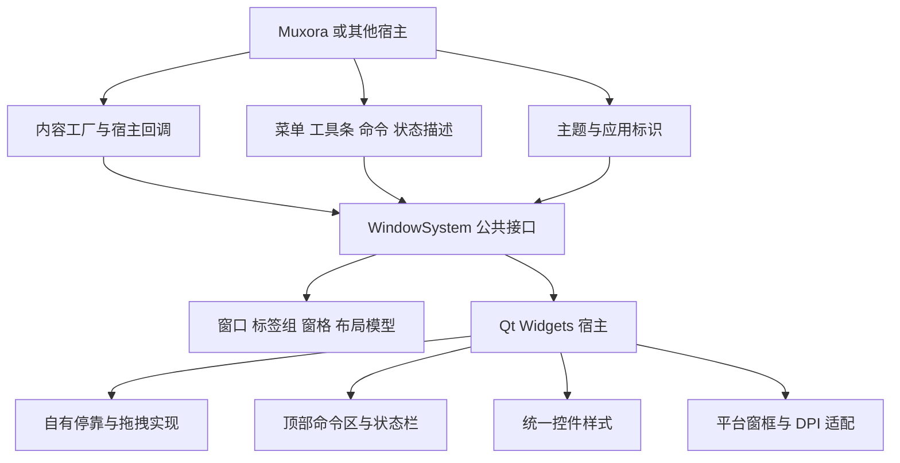

# WindowSystem 通用窗口系统设计

版本：0.5，讨论稿\
日期：2026-10-16\
状态：模块划分、窗口壳与视觉规范的设计基线；首个预览开始实现。实际范围与验证结果见 [预览说明](../development/window-system-preview.md)。

## 1. 项目内的独立模块

窗口系统是一项可复用于其他项目的正式模块，位于 `modules/window-system/`，具有自己的公开接口、CMake 目标、测试和说明。当前与 Muxora 保持同一仓库；首个交互预览就是 Muxora 应用，后续产品继续在同一套代码上开发。

它负责通用桌面工作区：完整窗口与轻量浮窗、窗口族、顶部与底部工具区、全局状态栏、统一标签、四边栏、中央标签组、标签内窗格、命令与焦点路由、布局保存，以及这些组件的样式和平台窗口行为。

另外支持每个标签自己的可选顶部附加栏和底部信息栏；未设置或明确清空时不显示，也不预留高度。

Muxora 是第一个宿主。它负责 SSH、SFTP、Ghostty、会话来源、文件管理、传输任务、认证与业务状态。这些类型和库不能进入 WindowSystem 的公开头文件，也不能成为其构建依赖。

可复用性通过单独构建和外部宿主测试夹具验证，不只依靠目录名称表示。夹具仅用于自动化验证，不额外交付一个示例应用。

功能规范和公开 API 由本模块定义。V0 采用自有布局、停靠和拖拽实现，复用合适的 Qt 分割、菜单、绘制与事件能力，不引入 KDDockWidgets。模块自有代码采用 MIT 方向；现成组件以后按需求、许可和维护成本评估，不同时维护多套完整引擎，也不为了迁就供应方删减功能。SSH、加密和 VT 解析继续采用成熟库。

KDDockWidgets 能减少常规停靠工作，但不能自动提供本模块的两层布局、业务独立 API 和完整壳语义；深入定制还需核对公开／私有接口。自研承担相应状态机、拖拽、跨屏与生命周期责任，必须由完整自动化测试验证，不能把自研视为无风险。[官方架构](https://kdab.github.io/KDDockWidgets/architecture_and_concepts.html)、[接口边界](https://kdab.github.io/KDDockWidgets/private_api.html)

## 2. 职责与依赖方向



| 通用模块负责 | 宿主负责 |
| --- | --- |
| 创建两种工作区窗口、维护窗口族及类型转换。 | 应用名称、图标、菜单内容与业务入口。 |
| 统一 Tab／Group／Pane 和移动事务。 | 创建终端、文件浏览器、设置等内容实例。 |
| 分割、聚焦、尺寸、四边收纳与跨窗口移动。 | 创建 shell、文件端点、任务及业务资源。 |
| 命令注册、快捷键作用域与可用状态呈现。 | 业务命令的执行及业务权限判断。 |
| 顶部／底部条带的布局、锁定和全局状态容器。 | 每条工具条的命令、状态项内容及更新。 |
| 结构性布局快照与版本。 | 内容业务状态、存储位置与恢复策略。 |
| 请求关闭、视图可见性及尺寸通知。 | 是否允许关闭、必要确认及业务资源清理。 |

模块不会根据某个业务字符串判断“这是终端，所以要断 SSH”。宿主通过回调决定影响，模块处理通用窗口事务。

## 3. 最小公开接口

普通使用者通过公开 C++ API 直接操作，就像调用 Qt：创建窗口、添加标签、设置内容、设置上下附加栏、分割、移动、关闭及保存布局。下面仅示意调用方式，尚不是已经实现的函数签名：

```cpp
auto window = windows.createWindow(WindowKind::Workbench, options);
auto tab = windows.addTab(window, myContent);
windows.setTabTopBar(tab, navigationBar);
windows.setTabBottomBar(tab, informationBar);
windows.moveTabToEdge(tab, Edge::Right);
auto floating = windows.moveTabToNewWindow(tab, WindowKind::Floating);
windows.promoteToWorkbench(floating);
```

直接添加已有 QWidget 是基础入口。内容工厂只用于需要自动新建或恢复内容的场景；命令注册只用于统一菜单、快捷键等操作。它们是公开 API 的可选扩展方式，调用者不必先实现一套框架才能打开标签。

| 接口 | 用途 |
| --- | --- |
| `WindowManager`、`WorkspaceWindow` | 创建、激活、请求关闭、移动内容及获取布局快照。 |
| `WindowKind`、`WindowFamily` | 完整／轻量形态、唯一完整根、逻辑归属、升降级和改归属。 |
| `DockSurface`／`MovePayload` | 共用中央与四边布局；描述单标签、组或整窗移动，公开描述不暴露视图树。 |
| 类型转换／整窗移动 API | 保留稳定 ID，预检、预览并原子提交；取消和失败不关闭内容。 |
| `TabDescriptor`、`PaneDescriptor` | 稳定 ID、标题、图标、内容类型和宿主状态引用。 |
| `ContentFactory` | 宿主按内容类型创建 QWidget；移动现有内容不重新调用创建流程。 |
| `HostCallbacks` | 关闭判断、焦点、可见性、尺寸及生命周期通知。 |
| `CommandRegistry`、`CommandDispatcher` | 通用窗口命令与宿主业务命令的同一入口。 |
| `ChromeDescriptor` | 菜单条、工具条、状态项、稳定 ID 与初始布局。 |
| `TabBarsDescriptor`／附加栏设置 API | 设置、移除或显式隐藏某标签的顶部与底部栏。 |
| `ThemeProvider` | 色彩、尺寸、字体、图标与样式资源。 |
| `LayoutSnapshot` | 带版本的窗口与结构数据，不包含业务连接或裸指针。 |

不把 libssh、Ghostty、Muxora 会话对象或 KDDockWidgets 私有类型暴露到这些接口。宿主内容使用不透明 ID／状态；结构与业务分别序列化。

直接添加的 QWidget、内容工厂返回的视图和上下附加栏采用同一所有权契约：成功接入时模块接管 UI parent 与移动／销毁；失败时不接管。一个控件不能同时被两个容器拥有。普通替换／移除清理旧栏；需要复用旧控件时使用明确的 take 操作返还所有权。宿主持有的业务资源仍独立管理，不能安排第二个视图释放者。

异步关闭结果按请求 ID 校验，布局移动不能触发业务关闭。

公开 API 按模块版本管理，优先保证源码复用和可控迁移。V0 不承诺永久 C++ ABI、运行中换库或第三方二进制插件兼容。

公共命令系统包括稳定 ID、参数 schema、执行前提、上下文与可绑定规则。所有通用公开操作都进入命令目录；宿主注册业务命令并注入用户规则，菜单、条带、面板和快捷键调用同一执行入口。模块提供按键解析与冲突诊断能力，但不读取 Muxora 的配置目录，不包含 SSH／终端模式的业务实现。[命令与快捷键规范](settings-and-commands-design.md)

窗口 API 显式区分创建、显示形态、逻辑归属和业务生命周期。升降级、整窗合并、族内／全局焦点 scope、悬停唤起及整族关闭均属于通用能力；宿主注入设置值及关闭许可。详见 [双窗口形态与跨窗口拖拽](floating-window-design.md)。

## 4. 模块内部结构与复用方式

```text
modules/window-system/
├── CMakeLists.txt
├── README.md
├── include/window_system/      # 精简公开头文件
├── src/
│   ├── model/                 # 窗口族、两种窗口、组、标签、窗格与事务
│   ├── commands/              # 命令、焦点及键位作用域
│   ├── chrome/                # 完整／轻量壳、菜单／工具条、状态栏
│   ├── docking/               # 共用布局、单标签／整窗拖拽、目标唤起
│   ├── panes/                 # 轻量递归窗格宿主
│   ├── style/                 # Qt 控件样式与主题令牌
│   └── platform/windows/      # 当前平台窗框与命中处理
├── themes/                    # 通用主题资源与图标
├── tests/                     # 布局、焦点、生命周期及 UI 场景
│   └── fixtures/external-host/ # 不含远程业务的公开 API 验证夹具
├── cmake/                     # 导出与依赖接入
└── docs/                      # 模块接口和决定记录
```

建议目标为 `WindowSystem::Model`、`WindowSystem::Widgets`，统一控件样式可另提供 `WindowSystem::Style`。它们是构建边界，不要求一律成为独立 DLL。

支持根工程以 `add_subdirectory()` 引入；也支持直接配置模块目录。需要时安装公开头文件和 CMake package，其他项目用 `find_package(WindowSystem CONFIG)` 接入。

模块不修改宿主的全局编译参数，不通过 Muxora 根目录定位资源。测试与安装选项使用 `WINDOW_SYSTEM_*` 名称；独立构建和嵌入构建的默认值分别处理。[CMake 顶层项目判断](https://cmake.org/cmake/help/latest/variable/PROJECT_IS_TOP_LEVEL.html)

模块自行声明 Qt 版本范围，以及选用第三方后端时的对应依赖；宿主可以显式提供兼容的已构建目标。独立配置不偷偷读取根工程的依赖文件，无论接入方式如何都使用同一套匹配的 Qt。

外部宿主夹具只添加文本／颜色等简单 QWidget、虚拟命令及状态项，用于验证公开 API、安装导出与窗口行为。独立构建不探测 SSH、Ghostty、Zig 或 Go，仅需要模块本身的 Qt、平台及实际选用的后端依赖。

Muxora 的 `src/workspace_host/` 只提供业务内容工厂、命令、状态和恢复回调，不再保留一套平行的通用窗口引擎。

## 5. V0 外观基准

**V0 以用户提供的 Visual Studio 2019 之后的截图为直接参考，使用紫罗兰色系。** 参考对象是 Visual Studio，不是 Visual Studio Code。此前讨论的 Aero 作为未来主题扩展，当前不作为默认外观。

首个预览暂不设计或添加应用 logo；顶部先提供菜单、工具与标题按钮。后续应用标识通过宿主接口接入，不把固定 logo 放入通用窗口模块。

参考范围包括：顶部融合菜单与命令条、紧凑控件、标签外形、活动／非活动区、侧边条、停靠标题、图形投放指示、表格与树、菜单、底部状态栏和统一间距。

宿主使用自己的菜单、功能与标识。截图中的项目菜单、调试配置和账户内容只作为布局示例；V0 不复制不属于远程工作空间的业务。

```text
┌──────────────────────────────────────────────────────────────────┐
│ 标识  [可移动菜单条] [搜索／标题等命令块]  拖窗区  _  □  ×       │
│ [可移动连接条] [可移动文件条] [其他命令块]                         │
├──────────────────────────────────────────────────────────────────┤
│ 四边栏／固定边缘区域／中央标签组／标签内窗格                       │
├──────────────────────────────────────────────────────────────────┤
│ 就绪／当前操作                 连接／传输摘要／通知等状态项         │
└──────────────────────────────────────────────────────────────────┘
```

上图为完整工作窗口：最上方直接是融合的应用命令区，不在它上面再叠一条传统标题栏。窗口控制、必需拖窗位置和安全空间由壳管理；菜单及命令块由可定制布局管理。

轻量浮窗参考用户补充的 Visual Studio 截图：在标题同一行最左侧提供本窗口菜单，随后为标题和窗口控制，不另加菜单行，不创建完整工作区按钮条或全局状态栏。菜单按本浮窗当前标签／窗格执行，省去退出整个应用等全局入口。它仍可正常最小化、最大化、调整尺寸与关闭，保留标签自己的上下栏；没有条目时四边隐藏。两种外壳共用主题和内容布局，不为浮窗创建一套看不见的完整外壳控件。

## 6. 顶部与底部工具条

菜单条和其他工具条采用统一 `CommandStrip` 布局，共用条带注册、弹性规则、压缩、溢出和锁定。顶部与底部均支持任意多行；菜单是其中一种内容，可以跨区移动。

底部工具区在下侧收纳条和工作区内容之下、全局状态栏之上。行号从各区外侧开始：顶部第 0 行靠窗口上边缘，后续行向下生长；底部第 0 行靠全局状态栏，后续行向上生长。普通工具行以 28 个逻辑像素为基准，字体或内容要求更高时随之扩展；窗口控制仍保留完整的 32 像素高度。

拖动到某区最后一行时，在工作区一侧显示一行空白投放预览；继续移动到预览可创建下一行。顶部预览在下方，底部预览在上方。空行平时不占空间，来源行最后一条工具条被拖走后立即消失，取消时恢复原布局。行索引可以保留隐藏条带的恢复位置，控件创建与绘制只随实际内容和当前预览增长。

### 6.1 解锁与锁定

- 默认布局锁定；菜单与命令继续可用，锁定只禁止位置调整。
- 解锁后显示拖动柄。菜单条、工具条及独立命令块可改变顺序、所在行，或在顶部和底部之间移动。
- 条带可以并排、换行或移到另一区；窗口按钮和合法拖窗区域继续遵守宿主约束。
- 拖动显示插入目标和预览，Esc 取消。
- 锁定后隐藏拖柄并禁止布局修改；保存行、顺序、位置、可见性和锁定状态。
- 提供恢复默认布局，以及键盘／命令方式的重排操作。

默认移动单元是菜单条、工具条或宿主注册的命令块，可以包含按钮、组合框、输入控件等。V0 不要求在运行中任意拆开一套菜单的内部菜单项；条带内部内容仍由宿主描述定义。

工具条重排与内容标签停靠是两套操作：顶部／底部工具区使用条带插入和换行，工作区使用标签组、四边和窗格投放；两者不混用目标。

公开操作 `WindowManager::moveToolbar(window, stripId, ToolbarArea::Top/Bottom, row, index)` 使用区内从 0 开始的行号和插入位置，`index = -1` 表示末尾。可以选择已有行或在末尾添加一行；无效条带、区域、跳跃行号和越界索引须在创建控件或修改布局前拒绝。`window.toolbar.move` 支持相同参数，缺参时依次提供工具条及“顶部／底部 → 已有行／新一行”的键盘选择器，全部命令可绑定快捷键。

每条工具条可采用内容宽度或弹性空间策略，每行最多保留一条弹性工具条。它在所在行的任意位置占用剩余空间，将右侧条带推到右边。标题是强制弹性条，其行内不允许其他弹性条；拖入的弹性条改为普通条。强制策略由宿主约束决定，优先于用户布局。没有强制弹性条的行允许新设置或移入的弹性条替换原归属，旧多弹性布局按保存顺序保留最后一条。弹性只控制尺寸，输入框、组合框等交互内容仍正常接收输入，只有明确标记的标题区域承担拖窗。尺寸策略随布局保存，旧布局缺少该字段时沿用宿主默认值。

宿主可为特殊条带设置呈现约束，独立于用户布局。窗口控制条带保留三个完整按钮的最小宽度，可拉伸，不允许弹性且没有选项按钮；完整和轻量窗口使用同一条带布局及锁定命令。拖走相邻条带后的空间回收、弹性右侧条带的边界调整按 [交互修订](window-interaction-design.md) 实施。

标题在自身条带的内容区居中，宽度不足时在右侧省略，保留完整文本供窗口标题及可访问名称使用，标题区域悬停不显示气泡。宿主规定标题内容区至少 96 个逻辑像素，把手另计；用户布局不能突破宿主的最小宽度。

条带选项提供“重置尺寸”。`WindowManager::resetToolbarWidth(window, stripId)` 与 `window.toolbar.resetSize` 使用同一操作；命令接受 `strip` 参数，无参数时提供可用键盘选择的工具条列表。重置仅恢复目标的自然宽度，不修改其他条带的请求宽度或排列顺序。目标在弹性左侧或该行没有弹性时保持左端，在弹性右侧时保持右端，在相应方向分配或收回空间；先调整弹性空间，不足时按最小宽度压缩。隐藏条带不影响可见布局，弹性条带继续占用剩余空间。

### 6.2 窄窗口与交互

固定保留窗口按钮和合法拖窗区域。空间不足时通过条带换行、合理最小宽度与溢出菜单处理，不截掉重要命令或挤占窗口控件。

锁定禁止用户重排，但不禁止窄窗口的临时换行／溢出。响应式呈现不覆盖保存的行、顺序和偏移；恢复宽度后还原用户布局，不能将一次缩小窗口永久保存成另一个工具条布局。

缩小窗口先压缩弹性空间，再压缩普通条带。弹性右侧的条带直接从右边缘向左定位，最后一条与右边缘的间距保持不变；空间不足时从靠近弹性的一条开始压缩。左右两侧各自遵守最小宽度，避免累计位置造成右侧漂移。

保留 Alt 菜单访问、助记键、方向导航、Esc、快捷键和正确的菜单弹出位置。输入框区域正常编辑，不被窗口拖动命中拦截。条带锁定不改变命令启用状态，也不把禁用按钮当成拖动柄。

Qt `QToolBar` 提供可移动、区域和布局基础，但 `QMenuBar` 没有同等 movable 属性。可以评估 QToolBar／QWidgetAction 内的菜单控件；若限制较多，则采用自己的 MenuStrip 和顶部布局，复用合适的基础菜单能力。第一行融合、完整重排、溢出和键盘行为必须满足本模块规范。[QToolBar](https://doc.qt.io/qt-6/qtoolbar.html)、[QMenuBar](https://doc.qt.io/qt-6/qmenubar.html)、[QWidgetAction](https://doc.qt.io/qt-6/qwidgetaction.html)

## 7. 底部状态栏

每个完整工作区窗口默认显示底部状态栏，可单独隐藏。它是窗口壳的一部分，不作为可移走的工作区 Tab；隐藏后不保留高度，也不改变底部工具条的位置或内容归属。

轻量浮窗省去此全局栏，Tab／Pane 自有信息栏正常保留。升级为完整窗口后创建全局栏；降级后释放对应控件，状态服务按共享生命周期管理。

左侧呈现当前操作或就绪状态，右侧呈现宿主注册的连接、传输、通知或其他摘要。状态项使用稳定 ID、文本、图标、提示及可选命令；窗口模块不认识网络流量或认证的业务含义。

更新采用事件合并与受控频率，窗口尺寸不足时有优先级和溢出。正常状态栏不通过频繁跳动或改变高度打断布局，也不放入一个完整传输列表替代功能标签。

### 7.1 标签自己的上下附加栏

每个标签在标签标题条下面、实际内容上方可放顶部导航／操作栏，在内容下方可放底部信息栏。上栏可以是路径、范围选择、搜索、筛选或按钮，下栏可以是缩放、编码、位置、连接或选中项统计；内容由调用者设置。

```text
标签组标题条：[标签 A] [标签 B]
┌──────── 当前标签 A ────────┐
│ 可选顶部附加栏             │
│ 内容／PaneTree             │
│ 可选底部信息栏             │
└───────────────────────────┘
窗口底部全局状态栏
```

两栏分别可选。未设置、传入 null、显式移除，或描述式接口没有任何项时，整个栏及分隔线收起、占用高度为零。对于直接提供的 QWidget，由调用者显式控制显示；模块不根据控件文本或 children 数量猜测是否为空。两栏属于 Tab ID，切换标签时切换对应栏，移动到四边或独立窗口时随标签一起移动，不污染其他标签的状态。

多个窗格需要各自显示导航／信息时，也可使用同一轻量栏容器设置 Pane 级附加栏。Tab 级栏随整个标签移动；Pane 级栏随该窗格提取，不能把原标签的整套状态栏意外带给某个窗格。绑定活动窗格的 Tab 栏由调用者明确设置更新规则。

附加栏共享样式、DPI、焦点与可访问规则，不为没有栏的标签创建空控件或轮询状态。设置、替换和移除栏遵循模块的视图所有权规则。

### 7.2 独立显隐、全屏与禅模式

工具栏、全局状态栏、中央标签栏和四边收纳条是四个独立的窗口级偏好。普通窗口、窗口全屏、标签组全屏和窗格全屏共用同一组偏好；进入或退出全屏不自动改变它们。工具栏开关控制顶部和底部工具区。中央标签栏开关保留固定面板标签栏与临时展开标题；收纳条开关保留固定分区内容。

`ViewMode` 区分 `Normal`、`WindowFullscreen`、`GroupFullscreen` 和 `PaneFullscreen`。三个全屏范围都使用正常的顶层全屏窗口；窗口范围显示整个工作区，标签组范围只显示目标组的内容，窗格范围只显示目标 Pane 的内容。收纳条及窗口各栏仍按独立偏好显示。目标为收纳标签时，将原内容临时呈现在工作区；原模型、内容 ID、连接和控件实例保持，退出后恢复原位置与分割尺寸。

标签组范围固定 Group ID，允许切换该组的标签；窗格范围固定 Pane ID，同窗口移动时跟随其当前 Tab／Group。关闭目标或将其移到另一窗口后安全退出。明确激活范围外内容时退回窗口全屏，再显示所选内容。退出全屏恢复进入前的正常位置、尺寸和最大化状态，不用全屏的屏幕矩形覆盖正常位置。

普通窗口启用禅模式时，按设置一次进入窗口、标签组或窗格全屏，默认窗口全屏；已有全屏保留当前范围。开启后有效状态将四栏显示为关闭，并隐藏固定组标题、临时标题及 Tab／Pane 的上下附加栏；内容和栏控件不销毁。原四项偏好继续保存，关闭禅模式或退出全屏后恢复。禅模式中显示任意一栏会退出禅模式，先恢复原偏好，再应用这次显示操作；对已隐藏栏再次设为隐藏不改变保存的偏好。

宿主通过 `setToolbarsVisible`、`setStatusBarVisible`、`setTabBarsVisible` 和 `setSideBarsVisible` 设置偏好，通过 `preferredBarVisibility` 查看保存值，通过 `barVisibility`／`windowViewState` 查看禅模式覆盖后的有效状态。显示模式使用 `setViewMode`，禅模式使用 `setZenMode`。具体命令与默认键位见 [交互修订](window-interaction-design.md)。

## 8. 紫罗兰主题与统一控件

主题是一组可替换的色彩、尺寸、字体、图标和状态令牌。窗口系统接受主题，其他项目可以换配色；Muxora V0 选择 `vs-violet-light` 作为默认参考方案。

以下是初始调色方向，待实际控件与对比度检查后微调：

| 令牌 | 初始色值 | 用途 |
| --- | --- | --- |
| `shell.header` | `#DFD6F1` | 顶部菜单与工具条底色。 |
| `workspace.frame` | `#6A568C` | 工作区框架、停靠背景和边栏。 |
| `status.background` | `#4D356E` | 底部状态栏。 |
| `content.surface` | `#FAF8FD` | 普通内容背景。 |
| `content.text` | `#24212B` | 主要文字。 |
| `accent.primary` | `#8A52C7` | 活动标识及主要强调。 |
| `tab.active` | `#D9BDF5` | 活动标签背景。 |
| `tab.inactive` | `#BAA6D3` | 非活动标签背景。 |
| `control.hover` | `#ECE3F9` | 悬停反馈。 |
| `control.selected` | `#E2D0F4` | 列表与菜单选中背景。 |
| `control.outline` | `#9888B0` | 输入框等轮廓。 |

警告、错误、成功等保留可识别的语义色与图标。终端配色方案独立设置，紫罗兰框架不把远端真彩色全部改成紫色。

### 8.1 样式实现

统一主题、尺寸与交互语义是要求。可以使用 QCommonStyle／QProxyStyle、专用控件或组合方案，具体实现由功能与成本验证决定。能复用的标准控件保留输入、选择、键盘和可访问语义；停靠自定义部件和自绘内容读取同一主题。

采用 QStyle 方案时统一处理 `drawPrimitive`、`drawControl`、`drawComplexControl`、`pixelMetric`、`sizeFromContents`、`subControlRect` 与必要 `styleHint`；其他实现也要覆盖对应的状态、尺寸和命中。不能只换背景色后保留混杂的默认控件外观。[Qt 样式参考](https://doc.qt.io/qt-6/style-reference.html)

模块默认只为自己管理的窗口与附属弹层应用样式，不擅自修改宿主的 QApplication 全局样式。宿主内容和应用内对话框通过明确的主题入口接入；Muxora 可显式选择全应用采用同一风格。弹出菜单、提示等也要在对应样式作用域内创建，避免脱离窗口后回到默认皮肤。

覆盖范围包括菜单、工具条、按钮、输入框、组合框、复选框、单选框、树、列表、表格、标签、滚动条、分隔条、提示、应用内对话框、状态栏和窗口壳。检查普通、悬停、按下、选中、禁用、焦点及窗口非激活状态。

系统文件选择器等系统管理的窗口保留系统语义与外观；应用内控件不能混入未适配的 Qt 默认皮肤。宿主自定义 QWidget 的完整绘制由宿主负责，但必须使用共享令牌并通过视觉验收。

### 8.2 尺寸与密度

紧凑来自一致的尺寸与间距，不通过裁掉文字压缩行高。窗口界面字体默认以平台正常 GUI 字体为基础，终端字体链独立。

图标以 16／20 逻辑像素等明确档位设计；控件高度、行高和内边距结合 `QFontMetricsF` 计算。树表、输入框和工具按钮使用一致基线与少量可配置密度档位，避免无用途的大控件和过小的交互目标。截图中的物理像素不直接成为布局常量。[QFontMetricsF](https://doc.qt.io/qt-6/qfontmetricsf.html)

## 9. 原生窗口行为

自定义外观保留桌面窗口的实际能力：拖动、八方向 resize、最大化／恢复、最小化、系统菜单、任务栏、键盘关闭，以及 Windows 11 Snap。

Windows 的 `WindowFrameAdapter` 统一处理原生命中和窗口行为。Qt 6.9 起的 `ExpandedClientAreaHint`、`NoTitleBarBackgroundHint` 可作为一体化壳的候选基础，但不会自动完成条带重排、全部控件配色与原生交互。按实际 Qt 版本选择并验证方案。[Qt 扩展客户端说明](https://www.qt.io/blog/expanded-client-areas-and-safe-areas-in-qt-6.9)

标题按钮和拖窗区域的几何由壳显式管理，不能只依赖 safe-area 边距猜完整区域。自定义最大化按钮按 Windows 要求处理命中与默认窗口过程，验收悬停 Snap 菜单；不靠不断设置窗口坐标模拟系统移动缩放。[Windows 自定义窗框](https://learn.microsoft.com/en-us/windows/win32/dwm/customframe)、[Snap 布局](https://learn.microsoft.com/en-us/windows/apps/desktop/modernize/ui/apply-snap-layout-menu)

普通窗口和最大化窗口的最大化／恢复按钮使用相同命中规则。可见且启用的按钮矩形优先于顶部缩放区域，包括按钮的上沿；其他边缘和角仍保留原生缩放命中。全屏、紧凑拖拽预览及隐藏／禁用按钮不提供该命中。原生命中和 Qt 悬停回归可自动检查，Windows 11 实际 Snap 弹窗仍需在系统设置启用时验证。

关闭按钮、Alt+F4、系统菜单和命令入口走同一关闭协调流程。标准控件保留键盘与可访问信息，完全自绘的按钮或区域补足名称、角色、动作和状态。[Qt 无障碍支持](https://doc.qt.io/qt-6/accessible-qwidget.html)

两种顶层窗口的系统操作分别验收。轻量标题栏拖动支持整窗停靠；完整窗口标题栏仍是正常移动。拖拽中抬前目标与激活焦点分开，平台适配协调原生移动循环、捕获、层叠请求和拒绝结果。WindowFamily 不直接映射为 Qt parent／Win32 owner；浮窗可独立最小化，关闭完整根先统一取得全族关闭许可，不能依赖系统级联销毁。

V0 只实现和验收 Windows 平台窗框；其他系统以后提供对应适配，不要求它们照搬 Win32 的标题按钮位置。

## 10. High DPI 与清晰度

按目标屏幕原分辨率绘制文字、图标与边线，不接受系统低分辨率位图放大、旧屏幕缓存拉伸或缩放后命中错位。正常字体抗锯齿不算缺陷，清晰度按原分辨率查看。

Qt 6 在 Windows 默认使用 Per-Monitor DPI Aware V2，自动读取系统缩放。保留这一行为与 PassThrough 策略，正确处理 125%、150%、175% 等缩放；不套用 Qt 5 的启用标记，也不重复乘一个全局比例。[Qt High DPI](https://doc.qt.io/qt-6/highdpi.html)

布局、尺寸令牌与 Qt 事件使用逻辑坐标。位图缓存按目标窗口 DPR 分配物理像素并正确标记 DPR；DPR、字体、主题或内容变化时失效并按需重绘。缓存仍有容量上限，不永久为每种缩放保留完整副本。[QImage DPR](https://doc.qt.io/qt-6/qimage.html#setDevicePixelRatio)、[DPR 变化事件](https://doc.qt.io/qt-6/qevent.html#Type-enum)

图标优先采用可重新栅格化的 SVG，必要位图提供多分辨率资源。小图标按实际显示尺寸检查笔画与边线，不把“用了 SVG”当成已经清晰的证明。[QIcon](https://doc.qt.io/qt-6/qicon.html)

原生命中坐标与 Qt 坐标在平台适配中显式转换，考虑负坐标屏幕、每屏 DPI 和虚拟桌面间隙。不能用主屏 DPR 统一除所有全局坐标。[WM_NCHITTEST](https://learn.microsoft.com/en-us/windows/win32/inputdev/wm-nchittest)

终端和宿主其他自绘内容接收尺寸与 DPR 通知，按各自显示协议更新。通用模块不通过放大旧终端截图来适配新屏幕。

## 11. 保存与升级

结构快照包括窗口 kind、WindowId、FamilyId、完整根映射、正常几何与最大化状态、四边、标签组、PaneTree、顶部／底部条带布局、锁定状态、独立显隐偏好及全屏／禅模式与有效目标。主题引用使用稳定标识；宿主内容状态独立版本化。恢复先校验窗口族和内容目标，缺根按约定修复；拖拽中间态和系统层叠顺序不进入快照。

WindowSystem 提供布局快照与恢复 API，宿主选择存储位置和提交策略。Muxora 采用独立严格 JSON 状态文件，用户设置与快捷键则分别为 JSONC；窗口模块不将状态自行写入宿主 settings，也不依赖其文件组织。

工具条重置使用可选的 `naturalWidthPriority` 字段记录自然宽度优先级，未启用时不写入。每行最多保留一个；恢复多条优先级时按保存顺序保留最后一条。手调、尺寸策略变化及移动清除相关行的优先级，拖拽取消恢复原值。该字段不改变邻条保存的请求宽度。

业务内容类型未知时提供占位或宿主恢复策略，不让窗口模块自行构造不存在的会话。更新 Qt 或停靠库时，供应方格式变化由内部适配处理，公开结构保持可迁移。

模块升级除布局与资源检查外，还覆盖壳命中、菜单键盘、条带锁定、DPI、Snap、样式状态及旧布局恢复。可复用接口与部署方式分别记录版本。

## 12. 验收

验收条目必须落实为可追溯的自动化用例。模块具有独立测试入口，覆盖单独配置、嵌入构建、安装导出和外部宿主夹具仅通过公开 API 使用；不能只验证在 Muxora 中运行。

模型不变量、随机操作序列、真实拖拽和键盘、DPI、生命周期与资源检查共同验证复杂状态。失败后修复实现并保留回归用例，不得自行删用例、改预期、放宽阈值或屏蔽诊断。完整链路及标准修改规则见 [自动化测试与质量要求](../development/testing-design.md)。

| 项目 | 必须满足 |
| --- | --- |
| 独立性 | 单独配置模块及外部宿主夹具，不查找 SSH、Ghostty 或 Muxora 业务。 |
| 嵌入性 | 作为子目录或安装 package 接入另一宿主，公开接口无业务与供应方私有类型。 |
| 窗口外观 | 完整壳融合菜单与条带、底部全局状态栏；轻量壳在标题同一行提供局部菜单，两者窗口控制与 Tab 附加栏完整。浮窗菜单目标为本窗口，不重复全局退出等入口。 |
| 双窗口与窗口族 | 默认拖出轻量、升降级与改归属、整窗合并、空窗口设置及族关闭正确；所有内容 ID 和资源保持。 |
| 遮挡目标 | 单标签与标题栏拖动均能悬停唤起、选择完全遮挡窗口；捕获、焦点、取消、原生拒绝与混合 DPI 正确。 |
| 工具区布局 | 顶部／底部条带可跨区拖动、换位／任意多行，末行预览方向正确，空行无占位，隐藏条带恢复原位置；命令选择与公开 API 一致。 |
| 显隐与全屏 | 四项独立偏好在三种全屏范围中保持；禅模式覆盖并恢复，显示任一栏退出；内容和布局身份保持，退出恢复正常矩形及最大化状态。 |
| 标签附加栏 | 上下两栏独立可选，空则无占位；切换、收纳、跨窗口后显示与绑定正确，Pane 提取遵循对应归属。 |
| 狭窄窗口 | 命令合理换行／溢出，系统按钮和拖窗区域不被覆盖。 |
| 风格 | 全部应用内控件使用统一紫罗兰 VS 风格，紧凑、字体不裁切、状态完整。 |
| 100／125／150／175／200／250% | 菜单、控件、图标、终端、条带、状态栏、边线和命中正确；300% 扩展检查。 |
| 混合 DPI | 100↔150%、125↔200%、150↔250% 跨屏，主窗口、独立窗口、拖拽辅助、侧栏展开、菜单、提示及输入法候选位置清晰正确。 |
| 负坐标与屏幕移除 | 左／上方屏幕的命中与移动正确；移除屏幕后恢复窗口到可见区域。 |
| 动态显示变化 | 运行中改缩放、移动屏幕或移除屏幕后及时更新，不要求重启恢复清晰度。 |
| 原生交互 | 拖动贴边、Snap 悬停、八方向缩放、最大化不盖任务栏、Alt+Space／Alt+F4 正确。 |
| 键盘与可访问性 | 菜单 Alt／助记键／方向／Esc、命令、焦点及窗口按钮语义正常。 |
| 资源 | 重排、换屏、切主题和反复开关后缓存受控，无已确认泄漏；大量空／未知工具行不能生成等量无内容控件。 |
| 自动化与复用 | 独立 API／外部宿主、状态转换、桌面及资源检查有用例和证据；未执行不算通过，不降低标准来掩盖实现问题。 |

布局与分层导航的详细规则继续由工作区设计规定；本文件增加可复用模块、窗口壳、统一视觉与清晰度要求。
